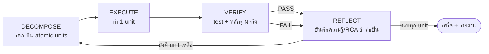

# Rule: Loop Engineering — Decompose & Tight Verification Loops

> กฎกลางสำหรับทั้ง Antigravity และ Cline: **ห้ามทำงานแบบ prompt engineering** (เขียน/แก้งานชุดใหญ่ทีเดียวแล้วหวังผล)
> ให้ทำงานแบบ **loop engineering** — แตกงานเป็นชิ้นเล็กที่สุด แล้ววน loop สั้น ๆ ที่จบด้วยการตรวจที่ชัดเจน

## 0. Why (ทำไมต้อง Loop Engineering)
- Automation ของ repo นี้แตะหลาย broker (Krungsri TradeMan, Settrade Click2Win, Liberator, Settrade Open API)
  ที่ DOM/เซสชัน/2FA เปลี่ยนบ่อย → งานชุดใหญ่ที่ verify ทีหลังสุดมักพังทั้งก้อนและแก้ยาก
- Loop engineering ให้ **fail fast**: เจอข้อผิดพลาดที่ unit เล็ก ๆ ทันที แก้ถูกจุด และไม่เสียเวลาทำงานชุดใหญ่แล้วมาแก้ทีเดียว
- ทุก loop ที่จบจะทิ้งความรู้ไว้ (PDCA/RCA) ให้ loop ถัดไปเร็วและแม่นขึ้น → งาน "ไม่ efficient" ลดลงเรื่อย ๆ

## 1. The Canonical Loop (วงวนมาตรฐาน — บังคับทุกงาน)
ทุกงานย่อยต้องผ่าน 5 เฟสนี้ตามลำดับ: **DECOMPOSE → EXECUTE → VERIFY → REFLECT → REPEAT**

1. **DECOMPOSE** — แตก task เป็น **atomic units** (1 function / 1 ไฟล์ / 1 call-site edit / 1 assertion / 1 browser action)
   - เขียนลงส่วน **`## Steps / Task Decomposition`** ในไฟล์ handoff (`docs/handoff/TASK-xxx.md`) **ก่อนเริ่มงาน**
   - แต่ละ unit ต้องมี: **Expected Outcome** (จะเห็น/ตรวจอะไร) + **วิธี Verify** (คำสั่ง test / หลักฐาน)
2. **EXECUTE** — ทำ **แค่ 1 unit ต่อ 1 loop** ห้าม batch งานที่ไม่เกี่ยวข้องกัน
3. **VERIFY** — ตรวจด้วย test จริง **บวก** หลักฐาน (screenshot / log / human confirm)
   - ถ้า FAIL → ห้ามข้ามไป unit ถัดไป ให้เข้า REFLECT ก่อน
4. **REFLECT** — หาต้นตอ (RCA 3 จุดตาม `root_cause_and_escalation.md`) และบันทึก RCA/PDCA ตาม `broker_pdca_rca.md`
5. **REPEAT** — วนกลับไป DECOMPOSE/EXECUTE unit ถัดไป โดยใช้ความรู้จาก loop ก่อนหน้า
   - ครบทุก unit แล้ว → ปิดงาน + รายงาน (Files changed / Summary / Tests run / Open questions)

## 2. Decomposition Rules (กฎการแตกงาน)
- **Atomic**: 1 unit = 1 action ที่ verify ได้อย่างอิสระ (ถ้า verify ไม่ได้อิสระ → ยังใหญ่เกินไป ให้แตกต่อ)
- **Ordered**: เรียงตาม dependency (shared helper → caller/driver → call-site → test → docs)
- **Gated**: ผู้ใช้ยืนยันแต่ละ gate ก่อนไป gate ถัดไป (ดู skill `stepwise-approval`)
- **No batch**: ห้ามแก้หลายไฟล์ที่ไม่เกี่ยวข้องแล้วมารายงานทีเดียว
- งานที่มาในไฟล์ handoff: ทำ **เฉพาะ scope ที่ระบุ** เจอนอก scope → บันทึกใน Open questions ห้ามแก้เอง

## 3. Verification Rules (กฎการตรวจ)
- **หนึ่ง unit = หนึ่งคำสั่ง verify** — ใช้ `scripts/verify_changes.py <ไฟล์ที่แก้>` เท่านั้น
  (รัน `compileall` บนไฟล์ที่แก้ + **เฉพาะ test ที่แมปกับไฟล์นั้น**) แล้วจบด้วย exit code:
  `0` = PASS · `1` = FAIL · `2` = BLOCKED / UNMAPPED / usage
  - ตัวอย่าง: `.venv/bin/python scripts/verify_changes.py app/services/line_service.py app/schemas/auth.py`
  - ดูแผนก่อนรัน (ถูกที่สุด): `--dry-run` · แมปใหม่ยังไม่มี: `--tests tests/test_x.py`
- **ห้ามรัน full suite ต่อ loop** — `.venv/bin/python scripts/verify_changes.py --full` ใช้
  **ครั้งเดียวตอนปิดงาน** เท่านั้น (บังคับจริง 2026-10-08: การรัน full suite ซ้ำ 3 รอบในงานเดียว
  ทำให้ loop บวม เวลา+token หมดเปล่า)
- **pytest single-writer** — ห้ามรัน pytest สองตัวพร้อมกัน: `test_homelab.db` มีตัวเดียว →
  SQLite lock/deadlock จริง (2026-10-08) · `verify_changes.py` gate ให้เอง (เห็น `BLOCKED` = ยังมีตัวเก่ารันอยู่ → รอ/ปิดก่อน)
- **ถ้า `--full` ค้าง ~87% เกิน 5 นาที = known issue** (SQLite lock บน `test_homelab.db`, ยังไม่แก้ —
  หลักฐาน stack ใน `docs/handoff/TASK-verify-loop-hook.md`): **kill ทันที + บันทึก Open questions**
  ห้ามรอเงียบ ๆ (เคสจริง 2026-10-08 เสีย loop ไป 20+ นาที × 2) · ระหว่างทางให้ใช้ targeted mode ซึ่งไม่สะสม state
- ไฟล์ที่ไม่มีการแมป → `UNMAPPED` (exit 2) **ห้ามเดา test เอง** (Anti-Mock) — ให้เพิ่ม mapping ที่
  `MODULE_TEST_MAP` ใน `scripts/verify_changes.py` (SSOT) แล้วเรียกซ้ำ
- ไฟล์ docs (`.md`/`.env` ฯลฯ) → `report-only` (ไม่มี test; verify = อ่านเทียบโค้ดตาม Zero-Contradiction §3)
- ทุก unit ต้องมี test / assertion ก่อนนับว่า "เสร็จ" (รันจริง ไม่ใช่คาดเดา)
- Hardware / browser → ต้องมีหลักฐานจริง **และ** human confirm (unit test ผ่านอย่างเดียวไม่นับ — ดู `stepwise-approval` §5)
- **Anti-Mock**: ห้ามรายงาน "✅" จากสมมติฐาน/ค่าปลอม ถ้าตรวจไม่ได้ให้รายงานตามจริงหรือ escalate
- Health check / preflight ต้องเรียกใช้ตัวตรวจตัวเดียวกับ driver จริง (single source of truth) — ดู `LIB-RCA-007`

## 4. Reflection Rules (กฎการสะท้อนความรู้)
- ทุก failure ที่แก้จนผ่านแล้ว → บันทึก RCA ลงไฟล์ RCA ของโบรกเกอร์นั้น (`broker_pdca_rca.md` §2)
- ทุก success ที่เปลี่ยน selectors/ลำดับขั้นตอน → อัปเดต runbook เดิมใน `learned_workflows/*.md` ทันที (Zero-Contradiction §3)
- บทเรียนต้องอยู่ในรูปแบบที่ loop ถัดไปใช้ได้ทันที (โค้ด/selector ที่พิสูจน์แล้ว + edge cases)

## 5. Efficiency Rules (แก้จุดที่ "ไม่ efficient")
- **ห้าม Big-Bang**: อย่าเขียนโค้ดชุดใหญ่แล้วค่อย test ทีเดียว — ให้ทำ unit → verify → ต่อ
- หนึ่ง loop ต้อง **สั้น** และจบด้วยผล verify ที่ชัดเจน (ผ่าน/ไม่ผ่าน + หลักฐาน)
- ถ้าติดในการ anneal เกิน ~3 attempts โดยไม่คืบหน้า → **escalate** (KDE Connect / ถามผู้ใช้) ห้ามวนไม่รู้จบ
- ทำเฉพาะ unit ถัดไปที่ปลดล็อกงาน — อย่าแอบขยาย scope หรือ refactor นอกแผน

## 6. Loop Budget (งบต่อ loop — บังคับหยุดเพื่อรีวิว)
ทุก loop มีงบจำกัด ถ้าเกินให้ **STOP & REVIEW** กับผู้ใช้ก่อนไปต่อ (ห้ามลากยาวเงียบ ๆ):

| ตัวชี้วัด | งบ | เมื่อเกินงบ |
|-----------|-----|-------------|
| เวลาต่อ unit | **15 นาที** | STOP & REVIEW |
| จำนวน tool-call ต่อ unit | **~20 calls** | STOP & REVIEW |
| จำนวนครั้ง self-anneal ต่อ failure | **3 attempts** | STOP & REVIEW + escalate (KDE Connect / ถามผู้ใช้) |

- ครบทุก unit ของ step ใหญ่ → **STOP & REVIEW** เสมอ: รายงาน Files changed / Tests run / ผลจริง ก่อนเริ่ม step ถัดไป
- ทุก unit ที่ verify ต้องแนบ **หลักฐานจริง** (output, exit code, log ไฟล์) — ห้ามสรุปด้วยความเชื่อ (Anti-Mock)
- งบนี้กัน "งานยาวที่ไม่จบ" (ไม่ efficient): ถ้าเห็นว่าใกล้เกินงบ ให้ **แตก unit ต่อ** ทันที ไม่ใช่พยายามอัดให้จบ
- failure ที่แก้จนผ่าน → ยกระดับเป็น RCA/PDCA (`broker_pdca_rca.md` §2) เพื่อให้ loop ถัดไปไม่ต้องเสียงบซ้ำ

> ตัวอย่างจริง (2026-10-08): unit `start_homelab.py --services` ล้มด้วย
> `SyntaxError: name 'GATEWAY_PORT' is used prior to global declaration`
> — จับได้เพราะ **รันจริง** ไม่ใช่เดา → แก้จุดเดียว จบใน 1 loop
> (ถ้าไป verify ทีหลังสุดตอนจบงาน จะพังพร้อมกันหลายไฟล์และหาต้นตอยาก)

## Cross-references
- `.agents/rules/broker_pdca_rca.md` — PDCA knowledge loop + Zero-Contradiction runbook reconciliation
- `.agents/rules/root_cause_and_escalation.md` — RCA 3 จุด, 4-step self-annealing, KDE Connect escalation
- `.agents/skills/stepwise-approval/SKILL.md` — แยกงานเป็น step, ระบุ expected outcome, verify กับผู้ใช้ทุก step
- `.agents/skills/watch-and-learn/SKILL.md` — 6-step learning loop + atomic checklist decomposition
- `scripts/verify_changes.py` — **verify hook** (targeted tests + compileall + pytest single-writer gate) ตาม §3
