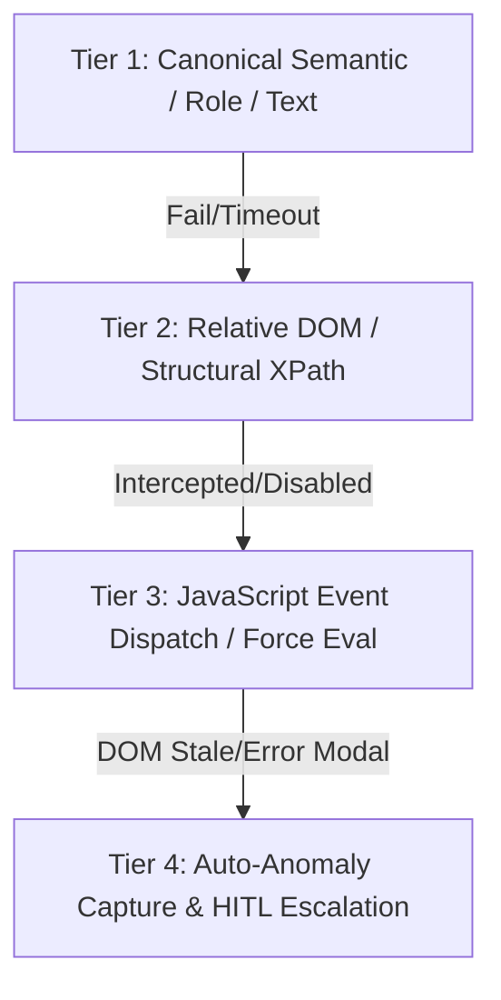

# Watch-and-Learn Interactive Co-piloting & Self-Annealing Skill

This skill defines the standardized protocol for collaborative web automation and continuous workflow self-annealing between the AI Agent and the Developer across all broker portals (Krungsri TradeMan, Settrade Click2Win, Settrade Streaming).

---

## 1. The 4-Tier Self-Annealing Playwright Protocol

When executing web automations on complex SPAs, never rely on brittle single-layer selectors. Every interaction must follow this 4-tier fallback pyramid:



1. **Tier 1: Canonical Semantic Locators**
   - Use role, placeholder, or exact text matches:
     `page.get_by_role("button", name="Submit")` or `page.locator("button:has-text('Submit')")`.
   - Fast and human-readable, but may break if the broker updates styling or localization.

2. **Tier 2: Relative Structural Locators**
   - Bind to stable parent containers or focusable controls:
     `div.bg-color-account-info-group span[tabindex='0']` -> `:text('CW32_D_')`.
   - Prevents strict mode collisions when generic CSS classes (e.g. `.css-1qr0s91`) match 400+ elements across the dashboard.

3. **Tier 3: JavaScript Evaluation & Event Dispatch**
   - If Playwright's `click()` is intercepted by an ephemeral backdrop (`.ReactModal__Overlay`) or pointer events are masked:
     ```python
     await btn.evaluate("e => e.click()")
     ```
   - Directly triggers the browser's native DOM click event, bypassing synthetic pointer checks while still firing React/Vue event listeners.

4. **Tier 4: Autonomous Anomaly Logging & Co-pilot Escalation**
   - If an unexpected error dialog appears (e.g. *"Symbol: Stock not found"* or *"Please select Long or Short"*):
     1. Automatically capture full-resolution screenshot to `data/screenshots/`.
     2. Log anomaly event to database (`WorkflowAnomaly` model).
     3. Send instant push notification via KDE Connect to mobile (`Xiaomi Mi 10T`).
     4. Halt further destructive actions and prompt developer in chat for interactive co-piloting.

---

## 2. TypeSafe Asset Class Segregation (Equity vs Derivatives)

Trading platforms (Settrade Streaming / Click2Win) maintain strictly segregated order entry forms and account contexts:

### A. Equity Workflow (`CW32_E_...` / Cash Balance)
- **Account Verification**: Ensure account text contains `CW32_E_` or `(Equity)`.
- **Allowed Assets**: SET/MAI stocks, DWs (e.g. `BDMS`, `DELTA`, `PTT`, `AWC01P2701A`).
- **Volume Rule**: Strict board lot enforcement (`volume % 100 == 0`).
- **Allowed Actions**: Strictly `BUY`, `SELL`, `OPEN_SHORT` (SBL), `COVER` (SBL).
  - *Strict TypeSafe Rule*: `LONG` is strictly rejected for Equity.
- **Side Controls**: `Buy` (Radio `val='B'`) vs `Sell` (Radio `val='S'`).
- **Submit Button**: `button.bg-color-submit-button` (`Submit` / `Buy` / `Sell`).

### B. Derivatives Workflow (`CW32_D_...` / Line Available & EE)
- **Account Verification**: Ensure account text contains `CW32_D_` or `(Derivatives)`.
  - *Account Switcher*: Click `div.bg-color-account-info-group span[tabindex='0']` -> Click `:text('CW32_D_')`.
- **Allowed Assets**: TFEX futures/options (`SPALIU26`, `ORIU26`, `S50U26`, `GOU26`).
- **Volume Rule**: Unit is contracts (`volume >= 1`, odd lots allowed).
- **Allowed Actions**: Strictly `LONG` and `SHORT`.
  - *Strict TypeSafe Rule*: `BUY`, `SELL`, `COVER`, `OPEN_SHORT` are strictly rejected for TFEX.
- **Side Controls**: `Long` (Radio `val='B'`, `label:has-text('Long')`) vs `Short` (Radio `val='S'`, `label:has-text('Short')`).
  - *Crucial*: Switching accounts clears radio selection! Must explicitly select `Long` or `Short` before submitting.
- **Position Dropdown**: Located next to the `○ Short` radio button. Supports `Open` (O), `Close` (C), `Auto` (smart portfolio reconciliation).
- **Submit Button**: Changes dynamic label to matching side (`button.bg-color-buy-button` labelled `"Long"`).
- **Confirmation Modal**: Intercepts submit with `"Order Confirmation"` dialog -> Click `div:has-text('Order Confirmation') button:has-text('Long')`.

---

## 3. The 6-Step Continuous Learning Loop

0. **Step 0: Pre-Flight Gatekeeper & Process Hygiene**:
   Run `scripts/preflight_check.py --clean` to ensure port 8000 is alive, zombie browser processes are purged, and broker session credentials exist (`data/session_state.json`) before launching browser.

1. **Step 1: Atomic Checklist Decomposition**:
   Decompose automation into: `[NAV]` -> `[DISMISS]` -> `[SWITCH_ACC]` -> `[FILL]` -> `[SUBMIT]` -> `[CONFIRM]` -> `[VERIFY]`.

2. **Step 2: Headed Session with Visual Highlights**:
   Launch Chromium on `DISPLAY=:0` using `click2win_auth_driver.launch_browser(resume_state=True)` with glowing element outlines (`outline: 3px solid #00ffcc`).

3. **Step 3: Interactive Verification**:
   Execute step-by-step with the developer, testing each action on the live page before committing to code.

4. **Step 4: Runbook Persistence**:
   Save verified sequences to `learned_workflows/<workflow_name>.md` with exact selectors, screenshots, and live table proofs.

5. **Step 5: Production Driver Sync**:
   Translate verified selectors into production driver methods in `app/browser/` (e.g. `click2win_driver.py`, `trademan_driver.py`) and test with regression unit tests.

---

## 4. The PDCA Continuous Broker Knowledge Loop

Whenever an anomaly, edge case, or selector failure is resolved during live testing:
1. **Plan & Do**: Diagnose the symptom, inspect live screenshots/HTML snapshots, and apply resilient multi-tag fallbacks (Tier 1-3).
2. **Check (Root Cause Analysis)**: Identify why the platform deviated (e.g., stacked Vuetify overlays, unhandled SSO redirect landing pages, radio button state wipes, SET tick size limits).
3. **Act (Knowledge Base & Runbook Reconciliation)**:
   - **Log the Incident**: Record entry in the broker's dedicated RCA file (`learned_workflows/rca_<broker>.md`).
   - **Reconcile Contradictions**: Update any existing markdown runbooks (`learned_workflows/*.md`) or directives that contain outdated or conflicting instructions.
   - **Verify Production Drivers**: Ensure the changes are reflected in production driver code and pass all regression tests so tomorrow's runs never solve the same problem twice.

