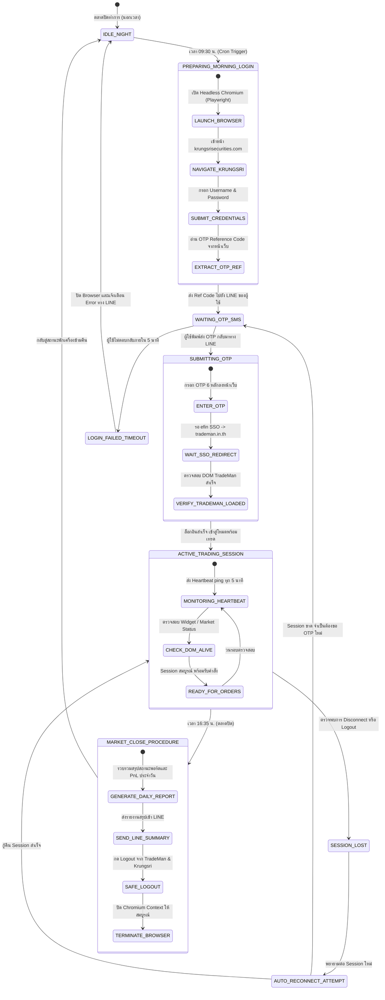
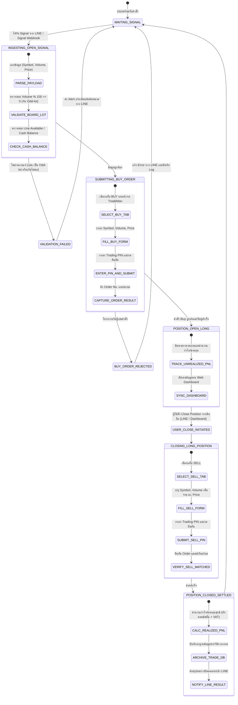
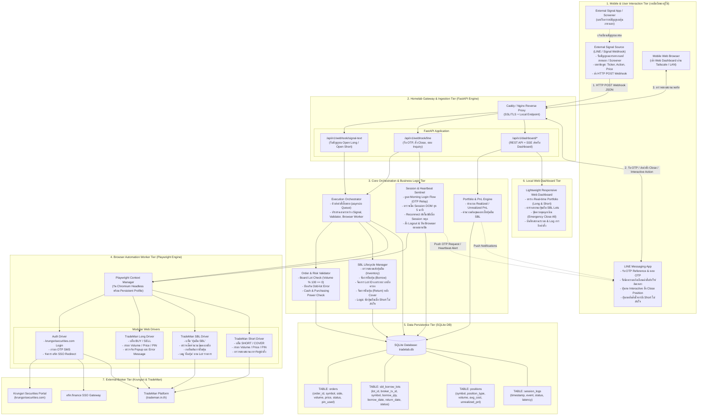

# Investment Homelab: System Architecture & Stage Diagrams
**ระบบช่วยเทรดกึ่งอัตโนมัติและการบริหารวงจรยืม-คืนหุ้น (Semi-Automated Trading & SBL Lifecycle Homelab)**

> [!NOTE]
> **หมายเหตุการปรับปรุงสถาปัตยกรรม (Architectural Evolution)**:
> เอกสารฉบับนี้เป็นข้อกำหนดเชิงประวัติศาสตร์จากการวิเคราะห์วิดีโอ 7 ชุด ปัจจุบันระบบได้ยกระดับเป็น **สถาปัตยกรรม 6 เสาหลัก (6-Pillars Modular Gateway)** ที่ผสาน **Settrade Open API (Real-time MQTT Ticks)** และ **Playwright Learned Workflows** สั่งการผ่าน Remote MCP โดยไม่มีการบล็อก DRY_RUN และแยกตัวจับเวลาออกไปภายนอก โปรดอ้างอิงแม่บทล่าสุดที่ [directive/phase3_detail.md](file:///home/araya-sawasdichai/Documents/antigravity/InvestmentHomelab/directive/phase3_detail.md) และ [automation_roadmap_status.md](file:///home/araya-sawasdichai/Documents/antigravity/InvestmentHomelab/automation_roadmap_status.md)

เอกสารนี้รวบรวมการวิเคราะห์จากบันทึกวิดีโอการใช้งานจริง (Screen Recordings 7 ชุด) และผลสรุปข้อกำหนดจากการสัมภาษณ์ความต้องการระบบ เพื่อใช้ออกแบบและพัฒนาระบบเทรดอัจฉริยะใน Homelab ที่เชื่อมต่อระหว่างมือถือ (LINE Bot / KDE Connect) กับหน้าเว็บซื้อขายหลักทรัพย์ TradeMan (Krungsri Securities) ผ่าน Headless Browser Automation (Playwright)

---

## 1. บทสรุปภาพรวมและที่มาของระบบ (Executive Summary & Operational Context)

จากการวิเคราะห์พฤติกรรมการเทรดจริงในบันทึกวิดีโอทั้ง 7 ไฟล์ พบขั้นตอนการปฏิบัติงานหลักและเงื่อนไขทางเทคนิค ดังนี้:
1. **การยืนยันตัวตนและการรักษา Session (Auth & Security):**
   - การเข้าใช้งาน Krungsri Securities ต้องกรอก Username/Password, รหัสผ่าน Master/PIN และต้องยืนยันตัวตนชั้นที่สองด้วย **SMS OTP** เสมอ
   - ระบบจะทำการ Single Sign-On (SSO) ผ่าน `efin.finance` เพื่อเปิดเว็บแอปพลิเคชัน `trademan.in.th`
   - ในการส่งคำสั่งซื้อขายทุกประเภท (Buy, Sell, Short, Cover) จะต้องกรอกรหัส **Trading PIN**
2. **วงจรการเทรดฝั่ง Long:**
   - ส่งคำสั่งซื้อ (BUY) ระบุ Symbol, Volume, Price, Trading PIN -> ระบบบันทึกเข้า Portfolio -> เมื่อต้องการปิดสถานะ ผู้ใช้ส่งคำสั่งขาย (SELL) เพื่อทำกำไร/ตัดขาดทุน
3. **วงจรการเทรดฝั่ง Short ผ่าน SBL (Securities Borrowing and Lending):**
   - **ขั้นตอนที่ 1 (ยืมหุ้น):** เข้าแท็บ `หุ้นยืม SBL` ค้นหารายการหุ้น ตรวจสอบจำนวนคงเหลือในคลัง (Available Inventory) ระบุจำนวนหุ้นที่ต้องการยืม แล้วกดยืนยันการยืมหุ้น
   - **ขั้นตอนที่ 2 (เปิดสถานะ Short):** สลับมาที่แท็บ `Trading A/C` เลือกคำสั่ง `SHORT` ระบุ Symbol, Volume, Price, Trading PIN -> ส่งคำสั่งขายชอร์ต
   - **ขั้นตอนที่ 3 (ปิดสถานะ Short / ซื้อคืน):** เมื่อต้องการปิดสถานะ เลือกคำสั่ง `COVER` เพื่อซื้อหุ้นคืนเข้าพอร์ต
   - **ขั้นตอนที่ 4 (คืนหุ้น SBL):** เข้าแท็บ `หุ้นยืม SBL` -> เลือกเมนู `คืนหุ้น` -> เลือกรายการ Lot ที่ยืมมา (ระบุวันที่ยืม, Transaction No.) -> ระบุจำนวนหุ้นเพื่อคืนเข้าคลัง SBL เพื่อหยุดการคิดดอกเบี้ยยืมหุ้นค้างคืน
4. **ข้อจำกัดและเงื่อนไขพิเศษที่ต้องควบคุม (Edge Cases from Video Observations):**
   - **Odd-lot Restriction:** ตลาดหลักทรัพย์ฯ และ TradeMan ไม่อนุญาตให้ส่งคำสั่งซื้อขายหุ้นเศษที่ไม่ครบล็อต (น้อยกว่า 100 หุ้น) ผ่านหน้าจอเทรดปกติ (พบ Error: `"Not sell oddlot Order"` ในวิดีโอที่ 2 จากการพยายามขายหุ้น 96 หุ้น) ดังนั้นระบบต้องตรวจสอบว่า Volume ต้องเป็นทวีคูณของ 100 หุ้นเสมอ
   - **SBL Borrowed but Short Unmatched:** กรณีที่ทำเรื่องยืมหุ้นสำเร็จแล้ว แต่คำสั่ง Short ไม่ถูกจับคู่ (Unmatched/Cancelled) **ต้องไม่คืนหุ้นทันที** แต่ให้ระบบพักหุ้นยืมไว้ และส่งการแจ้งเตือนมายัง LINE เพื่อให้ผู้ใช้ตัดสินใจว่าจะส่งคำสั่ง Short ซ้ำ (Retry) หรือส่งคืน SBL
   - **Session Reconnection:** ต้องมีกลไก Heartbeat ตรวจสอบ DOM ของ TradeMan ตลอดช่วงเวลาทำการ เพื่อป้องกันปัญหา Session Timeout และทำการ Reconnect หรือแจ้งเตือนให้ Re-login ทันที
   - **End of Day Cleanup:** เมื่อสิ้นสุดวันทำการ (16:35-17:00 น.) ระบบต้องทำการ Logout และปิด Chromium Browser ให้เรียบร้อยเพื่อความปลอดภัย

---

## 2. Stage Diagrams (แผนภาพสถานะการทำงาน)

### 2.1 System & Daily Session Lifecycle State Machine
แผนภาพแสดงวงจรชีวิตของระบบและ Session การเชื่อมต่อตลอด 24 ชั่วโมง



---

### 2.2 Long Position Lifecycle State Machine
แผนภาพแสดงสถานะของคำสั่งฝั่งซื้อ (Long) ตั้งแต่รับสัญญาณจนถึงการปิดสถานะทำกำไร/ตัดขาดทุน



---

### 2.3 Short Position & SBL Lifecycle State Machine
แผนภาพแสดงวงจรชีวิตการ Short Selling ผ่านกลไก SBL อย่างสมบูรณ์ รวมถึงการจัดการเคสข้อยกเว้นกรณี Short Order ไม่สำเร็จ

```mermaid
stateDiagram-v2
    [*] --> READY_WAITING_SIGNAL : สแตนด์บายรอรับคำสั่ง Short
    
    READY_WAITING_SIGNAL --> INGEST_SHORT_SIGNAL : ได้รับ Signal Open Short จาก LINE / Signal Webhook
    
    state INGEST_SHORT_SIGNAL {
        [*] --> VALIDATE_SHORT_LOT : ตรวจสอบว่า Volume เป็น Board Lot (Modulo 100 == 0)
        VALIDATE_SHORT_LOT --> CHECK_SBL_ELIGIBILITY : ตรวจสอบว่าเป็นหุ้นในลิสต์ SBL
    }
    
    INGEST_SHORT_SIGNAL --> SHORT_INPUT_INVALID : พบข้อผิดพลาด (เช่น ส่ง 96 หุ้น)
    SHORT_INPUT_INVALID --> READY_WAITING_SIGNAL : แจ้งเตือนสาเหตุทาง LINE และยกเลิก
    
    INGEST_SHORT_SIGNAL --> QUERYING_SBL_POOL : ข้อมูลผ่านเกณฑ์
    
    state QUERYING_SBL_POOL {
        [*] --> OPEN_SBL_TAB : เปิดแท็บ "หุ้นยืม SBL" ใน TradeMan
        OPEN_SBL_TAB --> SEARCH_STOCK_SBL : ค้นหาชื่อหุ้น (เช่น AP, HMPRO, DELTA)
        SEARCH_STOCK_SBL --> READ_AVAILABLE_QTY : อ่านจำนวนหุ้นคงเหลือที่ให้ยืมได้
    }
    
    QUERYING_SBL_POOL --> SBL_INSUFFICIENT_STOCK : จำนวนหุ้นในคลังไม่พอให้ยืม
    SBL_INSUFFICIENT_STOCK --> READY_WAITING_SIGNAL : แจ้งเตือนผู้ใช้ว่า "หุ้น SBL ไม่พอ"
    
    QUERYING_SBL_POOL --> EXECUTING_SBL_BORROW : มีหุ้นเพียงพอในคลัง
    
    state EXECUTING_SBL_BORROW {
        [*] --> FILL_BORROW_QTY : ระบุจำนวนหุ้นที่ต้องการยืม
        FILL_BORROW_QTY --> CONFIRM_BORROW_DIALOG : กดยืนยันการยืมหุ้น
        CONFIRM_BORROW_DIALOG --> RECORD_BORROW_LOT : บันทึก Borrow Lot ID, วันที่ยืม, จำนวนหุ้น
    }
    
    EXECUTING_SBL_BORROW --> SBL_BORROW_SUCCESS : ยืมหุ้นสำเร็จ ได้หุ้นเข้าพอร์ต SBL
    
    state EXECUTING_SHORT_ORDER {
        [*] --> SELECT_SHORT_TAB : สลับไปแท็บ Trading A/C -> SHORT
        SELECT_SHORT_TAB --> FILL_SHORT_FORM : ระบุ Symbol, Volume, Price
        FILL_SHORT_FORM --> ENTER_PIN_CONFIRM_SHORT : กรอก Trading PIN และกดยืนยัน
        ENTER_PIN_CONFIRM_SHORT --> MONITOR_SHORT_MATCH : ตรวจสอบผลการจับคู่คำสั่ง
    }
    
    SBL_BORROW_SUCCESS --> EXECUTING_SHORT_ORDER
    
    EXECUTING_SHORT_ORDER --> SHORT_MATCHED_SUCCESS : คำสั่ง Short ถูกจับคู่สำเร็จ (Filled)
    EXECUTING_SHORT_ORDER --> SHORT_ORDER_FAILED_OR_CANCELLED : คำสั่ง Short โดน Reject หรือหลุดราคา

    %% Branch ข้อยกเว้นพิเศษ: Short ไม่สำเร็จ ห้ามคืนหุ้นทันที ให้พักไว้และถามผู้ใช้
    state SHORT_ORDER_FAILED_OR_CANCELLED {
        [*] --> HOLD_BORROWED_SHARES : พักหุ้นยืมไว้ในพอร์ต (ไม่คืนทันที)
        HOLD_BORROWED_SHARES --> SEND_LINE_INQUIRY : ส่ง Interactive Message ถามผู้ใช้ทาง LINE
    }
    
    SHORT_ORDER_FAILED_OR_CANCELLED --> PROMPT_USER_DECISION : รอการตัดสินใจจากผู้ใช้
    
    state PROMPT_USER_DECISION {
        [*] --> USER_CHOICE_MENU : ตัวเลือก: [1] สั่ง Short ใหม่ (Retry) หรือ [2] ส่งคืน SBL ทันที
    }
    
    PROMPT_USER_DECISION --> EXECUTING_SHORT_ORDER : ผู้ใช้เลือก [1] ปรับราคาแล้วกด Retry Short
    PROMPT_USER_DECISION --> SBL_RETURN_EXECUTION : ผู้ใช้เลือก [2] ยกเลิกแผนและส่งคืนหุ้น SBL
    
    %% สถานะปกติเมื่อ Short สำเร็จ
    SHORT_MATCHED_SUCCESS --> POSITION_OPEN_SHORT : เปิดสถานะ Short สำเร็จ
    
    state POSITION_OPEN_SHORT {
        [*] --> MONITOR_SHORT_POSITION : ติดตามราคาตลาดและประเมิน Unrealized PnL
        MONITOR_SHORT_POSITION --> TRACK_BORROW_FEES : คำนวณดอกเบี้ยหุ้นยืมสะสมตามวัน
    }
    
    POSITION_OPEN_SHORT --> USER_CLOSE_SHORT_TRIGGERED : ผู้ใช้ส่งคำสั่ง Close Short (จาก LINE / Web Dashboard)
    
    state EXECUTING_COVER_ORDER {
        [*] --> SELECT_COVER_TAB : เลือกแท็บ COVER ใน TradeMan
        SELECT_COVER_TAB --> FILL_COVER_FORM : ระบุ Symbol, Volume, Price ที่ต้องการซื้อคืน
        FILL_COVER_FORM --> SUBMIT_COVER_PIN : กรอก Trading PIN และกดยืนยัน
        SUBMIT_COVER_PIN --> WAIT_COVER_FILLED : รอจนกระทั่งคำสั่ง Cover จับคู่สมบูรณ์
    }
    
    USER_CLOSE_SHORT_TRIGGERED --> EXECUTING_COVER_ORDER
    EXECUTING_COVER_ORDER --> SBL_RETURN_EXECUTION : หุ้นถูกซื้อคืนครบถ้วน พร้อมคืน SBL
    
    state SBL_RETURN_EXECUTION {
        [*] --> OPEN_SBL_RETURN_MENU : เข้าแท็บ SBL -> เมนู "คืนหุ้น"
        OPEN_SBL_RETURN_MENU --> MATCH_BORROW_LOTS : จับคู่ Lot รายการยืมเดิม (วันที่, เลขที่ทำรายการ)
        MATCH_BORROW_LOTS --> SUBMIT_RETURN_QTY : ระบุจำนวนหุ้นคืนแต่ละ Lot
        SUBMIT_RETURN_QTY --> CONFIRM_RETURN_POPUP : กดยืนยันการคืนหุ้น
        CONFIRM_RETURN_POPUP --> VERIFY_RETURN_SUCCESS : ตรวจสอบข้อความ "คืนหุ้นสำเร็จ!"
    }
    
    SBL_RETURN_EXECUTION --> SHORT_POSITION_FULLY_CLOSED : คืนหุ้นเรียบร้อย
    
    state SHORT_POSITION_FULLY_CLOSED {
        [*] --> CALC_NET_SHORT_PNL : คำนวณกำไร/ขาดทุนสุทธิ (หักค่าธรรมเนียมยืมหุ้น SBL)
        CALC_NET_SHORT_PNL --> UPDATE_DB_STATE : บันทึกลงฐานข้อมูลและเคลียร์ Lot SBL
        UPDATE_DB_STATE --> NOTIFY_LINE_SUMMARY : ส่งสรุปกำไรและผลการคืนหุ้นเข้า LINE
    }
    
    SHORT_POSITION_FULLY_CLOSED --> READY_WAITING_SIGNAL
```



---

## 3. System Component Diagram (สถาปัตยกรรมระบบองค์ประกอบ)

แผนภาพแสดงสถาปัตยกรรมเชิงระบบ (System Component Architecture) แสดงการแบ่งหน้าที่การทำงานระหว่างอุปกรณ์มือถือ, เซิร์ฟเวอร์ Homelab, ฐานข้อมูล, และโบรกเกอร์ภายนอก



---

## 4. รายละเอียดองค์ประกอบระบบเชิงลึก (Detailed Component Specifications)

### 4.1 Mobile Client Tier
1. **External Signal Ingestion (LINE / Signal Webhook):**
   - **Trigger:** รับสัญญาณเทรดจากแอปสัญญาณภายนอก / Screener (เมื่อมีข้อความเช่น `"BUY TRUE @ 13.20 Vol: 3800"` หรือ `"SHORT AP @ 8.20 Vol: 5000"`)
   - **Action:** ดึงค่าด้วย Regular Expression แล้วส่ง HTTP Request เมธอด `POST` มายัง Homelab Webhook:
     ```json
     {
       "source": "line",
       "action": "OPEN_SHORT",
       "symbol": "AP",
       "volume": 5000,
       "price": 8.20,
       "auth_token": "HOMELAB_SECRET_KEY"
     }
     ```
2. **LINE Messaging API (Interactive Bot):**
   - **Morning OTP Relay:** เมื่อบอทเตรียมล็อกอิน จะส่งข้อความหาผู้ใช้: `"[Homelab] รบกวนกรอก OTP สำหรับ Krungsri (Ref: BIPE)"` เมื่อผู้ใช้ตอบกลับเป็นตัวเลข 6 หลัก บอทจะนำไปกรอกบนหน้าเว็บทันที
   - **Manual Close Position Trigger:** ผู้ใช้สามารถสั่งปิดสถานะได้ด้วยตนเองผ่านปุ่ม Quick Reply หรือคำสั่งแชท เช่น `Close AP` หรือ `Close HMPRO`
   - **Unmatched Short Inquiry:** เมื่อเกิดกรณีคำสั่ง Short ไม่จับคู่ บอทจะส่งปุ่มกดให้เลือกทันที:
     - `[🔄 ปรับราคา Short]`
     - `[↩️ ยกเลิกและคืนหุ้น SBL ทันที]`

### 4.2 Homelab Core Engine Tier
1. **Order & Risk Validator:**
   - **Odd-lot Enforcement:** ตรวจสอบ `volume % 100 == 0` อย่างเคร่งครัด หากพบเศษหุ้น (เช่น 96 หุ้น) ระบบจะปฏิเสธคำสั่งทันที และแจ้งเตือนผู้ใช้ เพื่อป้องกัน Error บน TradeMan
   - **Price Tick Validation:** ตรวจสอบว่าราคาเสนอซื้อ/ขายตรงกับช่วง Spread ของตลาดหลักทรัพย์ฯ (Tick Size)
2. **SBL Lifecycle Manager:**
   - เก็บข้อมูลการยืมหุ้นลงตาราง `sbl_borrow_lots` โดยบันทึก `broker_tx_id`, `borrow_date`, `symbol`, `qty`
   - คำนวณค่าธรรมเนียมการยืมหุ้นรายวัน (Borrow Fee Rate เช่น 3.5% - 5.5% ต่อปี)
   - เมื่อผู้ใช้สั่ง Close Short และคำสั่ง Cover แมตช์เรียบร้อย ระบบจะทำเรื่องคืนหุ้นตามรายการ Lot ยืมเดิม และอัปเดตสถานะเป็น `RETURNED`
3. **Session & Heartbeat Sentinel:**
   - ทำงานใน Background Task (asyncio loop)
   - สุ่มตรวจสอบ DOM Elements ใน TradeMan ทุก 5 นาที (เช่น ตรวจสอบว่าตัวเลข SET Index หรือ Portfolio Balance ยังอัปเดตอยู่หรือไม่)
   - หากพบหน้าต่าง Session Timeout หรือ Redirect หลุดออกไปหน้า Login ระบบจะส่งแจ้งเตือนและพยายาม Reconnect ทันที
   - เวลา 16:35 น. เรียกใช้งานเมนู Logout บนหน้าเว็บ TradeMan และ Krungsri จากนั้นเรียก `browser.close()`

### 4.3 Browser Automation Worker Tier (Playwright)
- ใช้ **Playwright for Python** (Async API)
- ตั้งค่า User-Agent และ Viewport ให้เสมือน Desktop Browser ปกติ
- เก็บข้อมูล Session State / Cookies ไว้อย่างปลอดภัยในโฟลเดอร์ควบคุม
- จัดการ Element Selectors อย่างยืดหยุ่น โดยอ้างอิงจาก DOM โครงสร้างของ TradeMan ที่พบในคลิป:
  - เมนูแท็บ: `Portfolio`, `หุ้นยืม SBL`, `Trading A/C`
  - ปุ่ม Action: `BUY`, `SELL`, `SHORT`, `COVER`
  - ช่องกรอกข้อมูล: `Symbol`, `Volume`, `Price`, `PIN`
  - ตารางประวัติ: `รายการหุ้นยืม`, `คืนหุ้น`

### 4.4 Data Persistence Tier (SQLite Schema)
```sql
-- ตารางบันทึกประวัติการส่งคำสั่งซื้อขาย
CREATE TABLE orders (
    order_id TEXT PRIMARY KEY,
    broker_order_no TEXT,
    symbol TEXT NOT NULL,
    side TEXT NOT NULL, -- BUY, SELL, SHORT, COVER
    volume INTEGER NOT NULL,
    price REAL NOT NULL,
    status TEXT NOT NULL, -- PENDING, SUBMITTED, FILLED, REJECTED, CANCELLED
    error_message TEXT,
    created_at TIMESTAMP DEFAULT CURRENT_TIMESTAMP,
    updated_at TIMESTAMP DEFAULT CURRENT_TIMESTAMP
);

-- ตารางติดตามวงจรชีวิตหุ้นยืม SBL
CREATE TABLE sbl_borrow_lots (
    lot_id TEXT PRIMARY KEY,
    broker_tx_id TEXT, -- รหัสรายการยืมจากโบรกเกอร์ (เช่น 8493414)
    symbol TEXT NOT NULL,
    borrow_qty INTEGER NOT NULL,
    remaining_qty INTEGER NOT NULL,
    borrow_price REAL,
    borrow_fee_rate REAL DEFAULT 3.50,
    borrow_date DATE NOT NULL,
    return_date DATE,
    status TEXT NOT NULL -- ACTIVE, PARTIAL_RETURNED, FULLY_RETURNED, HELD_UNMATCHED
);

-- ตารางบันทึกสถานะการถือครองปัจจุบัน (Current Portfolio)
CREATE TABLE positions (
    symbol TEXT PRIMARY KEY,
    position_type TEXT NOT NULL, -- LONG, SHORT
    volume INTEGER NOT NULL,
    avg_cost REAL NOT NULL,
    current_price REAL,
    unrealized_pnl REAL,
    associated_sbl_lot_id TEXT,
    opened_at TIMESTAMP DEFAULT CURRENT_TIMESTAMP,
    updated_at TIMESTAMP DEFAULT CURRENT_TIMESTAMP,
    FOREIGN KEY(associated_sbl_lot_id) REFERENCES sbl_borrow_lots(lot_id)
);

-- ตารางบันทึกสถานะการเชื่อมต่อและ Heartbeat
CREATE TABLE session_logs (
    id INTEGER PRIMARY KEY AUTOINCREMENT,
    event_type TEXT NOT NULL, -- LOGIN_SUCCESS, HEARTBEAT_OK, RECONNECT, LOGOUT
    details TEXT,
    created_at TIMESTAMP DEFAULT CURRENT_TIMESTAMP
);
```

---

## 5. ตารางสรุปการจัดการสภาวะผิดปกติ (Exception & Failure Recovery Matrix)

| สถานการณ์ความผิดปกติ | ผลลัพธ์ที่เคยพบบนคลิป / ปัญหาที่อาจเกิด | วิธีการที่ระบบ Homelab ตรวจจับและจัดการ |
| :--- | :--- | :--- |
| **คำสั่งเศษหุ้น (Odd-lot)** | พบข้อความ Error: `ERROR: Not sell oddlot Order` (Video 2) | **Pre-trade Validation:** สกัดกั้นตั้งแต่ Gateway หาก `Volume % 100 != 0` จะยกเลิกคำสั่งทันทีและส่งแจ้งเตือนกลับทาง LINE โดยไม่ยิงไปที่ TradeMan |
| **กรอก Trading PIN ผิด** | พบข้อความ Error: `Error: Pincode Wrong` (Video 5) | เข้ารหัสและเก็บ PIN ที่ถูกต้องในระบบ Homelab (.env / Keyring) และมีระบบตรวจสอบการตอบสนองของ Dialog เพื่อแจ้งเตือนหาก PIN ผิดพลาด |
| **หุ้นในคลัง SBL ไม่พอให้ยืม** | ค้นหาหุ้นใน SBL แล้วจำนวนคงเหลือเป็น 0 หรือไม่พบหุ้น (Video 7) | ระบบอ่านค่าตัวเลขคลังหุ้นคงเหลือก่อนกดยืม หากไม่พอจะยกเลิกกระบวนการ Short ทั้งหมด และแจ้งเตือน `SBL Inventory Empty` ทันที |
| **ยืม SBL สำเร็จ แต่คำสั่ง Short ไม่จับคู่ / หลุดราคา** | หุ้นยืมตกค้างอยู่ในพอร์ต เสียดอกเบี้ยฟรีหากลืมคืน | **Logic พักหุ้นยืม:** บอทจะไม่คืนหุ้นทันที แต่จะพักไว้แล้วส่งข้อความถามผู้ใช้ทาง LINE พร้อมปุ่มตัวเลือก: [1] สั่ง Short ใหม่ หรือ [2] กดคืน SBL ทันที |
| **Session หลุดระหว่างวันทำการ** | Token หมดอายุ / หน้าเว็บกลับไปหน้า Login | **Heartbeat Sentinel:** ตรวจจับ DOM ทุก 5 นาที หากพบว่าหลุด จะพยายาม Reconnect ด้วยคุกกี้เดิม หรือส่งแจ้งเตือนขอ OTP ใหม่ทาง LINE ทันที |
| **ตลาดปิดทำการ (16:35 น.)** | ผู้ใช้ลืมปิดเบราว์เซอร์ ทรัพยากรเครื่องทำงานค้างคืน | **Evening Scheduler:** เวลา 16:35 น. ทำการปิดสถานะที่ค้างอยู่ (ถ้ามีเงื่อนไข), Logout ออกจากระบบทั้งสองชั้น และสั่ง Terminate Chromium Process อย่างสมบูรณ์ |

---

## 6. แนวทางการพัฒนาและขั้นตอนถัดไป (Implementation Roadmap)

1. **Phase 1: Database & Gateway Setup**
   - สร้าง SQLite Database ตาม Schema
   - พัฒนา FastAPI Endpoint สำหรับรับ Webhook จาก LINE Messaging Bot
2. **Phase 2: Playwright Driver & Session Management**
   - พัฒนาสคริปต์ Playwright สำหรับเข้าสู่ระบบ Krungsri ผ่าน SMS OTP Relay
   - พัฒนาระบบ Heartbeat Sentinel เพื่อตรวจเช็ค Session และ Reconnect
3. **Phase 3: SBL & Order Automation Engine**
   - เขียน Driver ควบคุมการยืมหุ้น คืนหุ้น และส่งคำสั่ง Short/Cover บน TradeMan
   - เขียน Driver ควบคุมการซื้อขายฝั่ง Long (Buy/Sell)
   - เพิ่มระบบ Pre-validation ป้องกัน Odd-lot
4. **Phase 4: Exception Handling & Notification**
   - ติดตั้งกลไกถามผู้ใช้ผ่าน LINE เมื่อ Short ไม่จับคู่
   - สรุปรายงาน PnL ประจำวันและการ Logout ปิดระบบอัตโนมัติ
5. **Phase 5: Mobile-Friendly Web Dashboard**
   - สร้างหน้า Web UI เรียบง่ายสำหรับมอนิเตอร์สถานะพอร์ตและกดสั่ง Close หรือสั่งงานฉุกเฉิน
