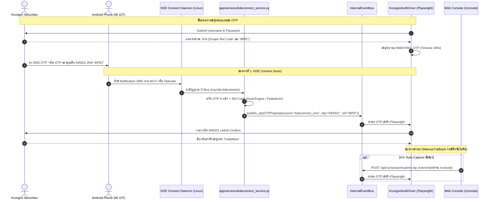

# Directive: KDE Connect Integration for InvestmentHomelab

> [!IMPORTANT]
> **SUPERSEDED (2026-10-08) — OTP relay ย้ายไป LINE group แล้ว**
> เอกสารนี้ยังใช้ได้เฉพาะ **mobile OTP checklist + D-Bus semantics ที่เป็นความรู้ทางเทคนิค**
> ส่วน **สถาปัตยกรรม OTP เปลี่ยนเป็น LINE group "a14s homelab"** เป็นช่องทางหลัก
> (ดู `docs/handoff/TASK-line-otp-group-relay.md` และ `rca/shared/rca_line_otp_group.md`)
>
> | หัวข้อในเอกสารนี้ | สถานะ 2026-10-08 |
> | :--- | :--- |
> | §2 ลำดับช่องทาง OTP (KDE = Priority 1) | ❌ ขัดกับของจริง → LINE group = Priority 1, `/console` = Priority 2, KDE = **dormant** |
> | §4 "ตัด LINE ออกจากระบบ OTP" | ❌ **กลับด้านแล้ว** → LINE คือช่องทางหลัก (SMS relay ผ่านกลุ่ม) |
> | §6.2 `kdeconnect_service` | ⚠️ โค้ดยังอยู่ (dormant) ไม่ได้ลบ — แต่ **ไม่ใช่ gate** อีกต่อไป |
> | §3 / `learned_workflows/shared/kdeconnect_mobile_otp_checklist.md` | ✅ ยังใช้ได้ถ้าจะรื้อ KDE กลับมา |
>
> Gate จริงตอนนี้คือ `app/services/otp_relay_readiness.py` (single source of truth)
> ที่ `auth_driver`, `liberator_driver`, `scripts/daily_readiness.py`,
> `scripts/start_homelab.py` (Stage 1) เรียกใช้ร่วมกัน

## 1. Overview & Objectives (ภาพรวมและวัตถุประสงค์)

เอกสาร Directive ฉบับนี้กำหนดข้อกำหนดทางสถาปัตยกรรม (Architectural Blueprint) และแนวทางการพัฒนา (Implementation Specification) ในการนำ **KDE Connect** มาเชื่อมต่อระหว่างเครื่องเซิร์ฟเวอร์ Linux Homelab (`home-lab`) กับสมาร์ตโฟน Android ของผู้ใช้งาน (`Mi 10T`) เพื่อทำหน้าที่เป็น **Hardware Bridge สำหรับการดักจับ SMS OTP และระบบแจ้งเตือนฉุกเฉินระดับวิกฤต**

### 1.1 วัตถุประสงค์หลัก
1. **Zero-Cloud Local SMS OTP Interception**: ดักจับรหัส SMS OTP 2FA จากธนาคาร/โบรกเกอร์ (เช่น Krungsri Securities) ที่ส่งเข้ามายังมือถือ แล้วส่งตรงเข้าสู่ `InternalEventBus` ของ Homelab แบบเรียลไทม์ โดยไม่ต้องพึ่งพาบริการภายนอก
2. **Dual-Network Continuity (Local Wi-Fi + Tailscale VPN)**: รองรับการทำงานทั้งขณะที่มือถืออยู่ในบ้านผ่าน Wi-Fi ท้องถิ่น และขณะอยู่นอกบ้านผ่าน Tailscale Mesh VPN
3. **Outbound Critical Alerts Only**: ส่งการแจ้งเตือนเหตุการณ์สำคัญระดับวิกฤต (Critical Alerts) จาก Homelab ตรงเข้าจอมือถือ (เช่น ตัดขาดทุน Cut Loss 5.1 สำเร็จ, เตือนคืนหุ้น SBL ก่อน 16:30 น., หรือ Session หลุด) เพื่อไม่ให้เกิดสแปม
4. **Channel Demarcation (อัปเดต 2026-10-08 — กลับด้านจากของเดิม)**: **LINE group `a14s homelab` คือช่องทาง OTP หลัก**
   (พิมพ์รหัส 6 หลักตอบกลับในกลุ่ม → webhook รับ → `event_bus.publish_otp(OTPSource.LINE_CHAT)`) โดยมี
   **Web Console (`/console`)** เป็น manual fallback และ **KDE Connect เป็น dormant** (ไม่ลบโค้ด แต่ไม่ใช่ gate)

---

## 2. ลำดับความสำคัญของช่องทาง OTP (OTP Relay Hierarchy)

ระบบกำหนดให้มี 2 ช่องทางหลักในการรับ OTP โดยทำงานประสานกันผ่าน `InternalEventBus` (ใครส่งเข้ามาก่อน ระบบจะหยิบไปใช้ยืนยันกับโบรกเกอร์ทันที):

| ระดับ | ช่องทาง (Channel) | โปรโตคอล / เครือข่าย | รูปแบบการทำงาน | สภาพแวดล้อมที่เหมาะสม |
| :---: | :--- | :--- | :--- | :--- |
| **Priority 1 (Auto) — 2026-10-08** | **LINE group `a14s homelab`** | HTTPS (cloudflared tunnel `https://line.a14s.dev` → `:8000/api/v1/webhook/line`) | บอท push คำขอ OTP เข้ากลุ่ม → ผู้ใช้พิมพ์รหัส 6 หลักตอบกลับ → webhook → `event_bus.publish_otp(LINE_CHAT)` | ทุกที่ (ไม่ต้อง pair มือถือ/ไม่ต้อง Tailscale) |
| **Priority 2 (Manual)** | **Web Console (`/console`)** | HTTP POST `/api/v1/session/submit-otp` | ผู้ใช้เปิดหน้าเว็บ Console กรอกรหัส 6 หลักด้วยตนเอง | กรณีระบบอัตโนมัติจับรหัสไม่ได้ |
| **Priority 3 (Dormant)** | **KDE Connect** | D-Bus / UDP-TCP 1714-1764 (Wi-Fi & Tailscale) | ดักจับ Notification SMS อัตโนมัติจาก Android (`poll_active_notifications`) | เฉพาะเมื่อ LINE relay ล่มและรื้อ KDE กลับมาใช้ (`allow_kde_fallback=True`) |

> [!IMPORTANT]
> **LINE Chat กลับมาเป็นช่องทาง OTP หลัก (2026-10-08)**:
> เดิมเอกสารนี้สั่ง "ยกเลิก LINE สำหรับ OTP" — **กลับด้านแล้ว** เพราะ LINE group แก้ปัญหา
> KDE-RCA-008 (SMS relay พังเพราะ `kdeconnect` ฝั่ง NUC คนละเวอร์ชันกับแอปมือถือ +
> GSConnect pairing หลุด) ได้ทั้งหมด: บอทเป็นผู้ส่งคำขอ OTP เอง ผู้ใช้ตอบกลับในกลุ่ม
> ไม่ต้องพึ่ง D-Bus notifications plugin ของ Android เลย
> (เดิมระบุว่า LINE Bot ใช้แค่รายงานกลยุทธ์/Action Center/EOD — ยังใช้อย่างนั้นได้ควบคู่กัน)
> [!WARNING]
> **GSConnect Pairing เป็นเงื่อนไขบังคับ (Operational Prerequisite)** — ช่องทาง OTP อัตโนมัติทำงานผ่าน
> **GSConnect's SMS plugin** ซึ่งเป็นตัวเขียน cache `~/.cache/gsconnect/incoming_notifications.jsonl` ที่แอปอ่าน
> (layer-4 fallback). ถ้า GSConnect หลุด **pairing** (`paired=false`) plugin จะถูกปิดทั้งหมด + packet ขาเข้า/ออกถูกทิ้ง
> → cache หยุดเขียน (ดู `rca/shared/rca_kdeconnect_bridge.md` → KDE-RCA-008 FINAL RESOLUTION).
> **ห้ามปิด/ถอด GSConnect (extension หรือ `gsconnect.service`) เพื่อ "เคลียร์อุปกรณ์ซ้ำ"** — มันคือ relay ตัวจริง.
> การที่มือถือเห็น "NUC-Intel" ซ้ำ 2 รายการคือ twin daemons (`kdeconnectd` + GSConnect) ที่คาดไว้.


---

## 3. สิ่งที่ต้องเตรียมบนมือถือ Android (Mobile Preparation Checklist)

เพื่อให้ KDE Connect บนสมาร์ตโฟน **Xiaomi Mi 10T (MIUI / HyperOS)** สามารถส่งต่อ SMS OTP และรับแจ้งเตือนได้ต่อเนื่องแม้ตอนจอดับ ผู้ใช้ต้องตั้งค่าบนมือถือดังนี้:

> [!TIP]
> **เช็กลิสต์ปฏิบัติการรายเครื่อง (Xiaomi Mi 10T Pro 5G / `M2007J3SY`):** ดู [`learned_workflows/shared/kdeconnect_mobile_otp_checklist.md`](../learned_workflows/shared/kdeconnect_mobile_otp_checklist.md)
> ไฟล์นั้นมีลำดับตรวจทีละขั้น (Battery = No restrictions -> Autostart -> Recent-Apps Lock -> Notification Access -> Permissions -> Plugin -> Tailscale), **ขั้น 0 แยกฝั่งมือถือ vs NUC**, และรอบตรวจซ้ำหลัง Reboot/อัปเดต MIUI
> หัวข้อ 3.1-3.3 ด้านล่างคือภาพรวม ส่วนไฟล์ข้างต้นคือเช็กลิสต์ที่ทำตามได้จริง

### 3.1 การอนุญาตสิทธิ์ของระบบ Android (Android System Permissions)
1. **สิทธิ์การเข้าถึงการแจ้งเตือน (Notification Access - สำคัญที่สุด)**:
   - เข้า **Settings (การตั้งค่า)** $\rightarrow$ **Apps (แอป)** $\rightarrow$ **Special app access (การเข้าถึงแอปพิเศษ)** $\rightarrow$ **Device & app notifications (การแจ้งเตือนของอุปกรณ์และแอป)**
   - ค้นหา **KDE Connect** $\rightarrow$ สวิตช์เป็น **Allow / อนุญาต**
2. **สิทธิ์การอ่าน SMS และโทรศัพท์ (SMS & Phone Permissions)**:
   - เข้า **Settings** $\rightarrow$ **Apps** $\rightarrow$ **Manage apps (จัดการแอป)** $\rightarrow$ เลือก **KDE Connect**
   - เข้าเมนู **Permissions (การอนุญาตของแอป)**:
     - **SMS**: ตั้งค่าเป็น **Allow (อนุญาต)**
     - **Phone & Call logs**: ตั้งค่าเป็น **Allow (อนุญาต)**
3. **การเปิด Autostart (เริ่มทำงานอัตโนมัติสำหรับ Xiaomi)**:
   - ในหน้า App Info ของ **KDE Connect** $\rightarrow$ เปิดสวิตช์ **Autostart (เริ่มทำงานอัตโนมัติ)** ให้เป็นสีฟ้า เพื่อไม่ให้แอปถูกปิดเมื่อเคลียร์ RAM
4. **การปลดล็อกการประหยัดพลังงาน (Battery Saver Restriction)**:
   - ในหน้า App Info ของ **KDE Connect** $\rightarrow$ **Battery saver (ตัวประหยัดแบตเตอรี่)**
   - เปลี่ยนจาก *MIUI Battery Saver* เป็น **No restrictions (ไม่มีข้อจำกัด)** เพื่อให้แอปทำงานเบื้องหลังได้ตลอดเวลาขณะจอดับ

### 3.2 การเปิดปลั๊กอินในแอป KDE Connect (App Plugin Settings)
เปิดแอป **KDE Connect** บนมือถือ $\rightarrow$ แตะที่ชื่อเครื่อง **`home-lab`** $\rightarrow$ แตะไอคอนฟันเฟือง **Plugin settings**:
- [x] **Notification sync (ส่งการแจ้งเตือน)**: เพื่อส่ง SMS ที่เด้งขึ้นหน้าจอไปยัง Linux
- [x] **Send notifications (รับการแจ้งเตือน)**: เพื่อรับ Critical Alerts จาก Homelab มาแสดงบนมือถือ
- [x] **SMS integration (การรวม SMS)**: เพื่อให้ Linux เข้าถึงข้อมูล SMS OTP
- [x] **Ping**: สำหรับทดสอบการเชื่อมต่อ

### 3.3 การตั้งค่า Tailscale เมื่ออยู่นอกบ้าน (Remote Outside Home)
1. เปิดแอป **Tailscale** บนมือถือ $\rightarrow$ กดเชื่อมต่อ (สถานะเป็น Connected และได้ IP เช่น `100.119.166.62`)
2. ในแอป **KDE Connect** บนมือถือ $\rightarrow$ เข้าเมนู 3 ขีด (มุมซ้ายบน) $\rightarrow$ **Settings** $\rightarrow$ **Add devices by IP**
3. ระบุ Tailscale IP ของเซิร์ฟเวอร์ Homelab: **`100.88.217.33`** $\rightarrow$ กด Add

---

## 4. ข้อมูลอุปกรณ์และเครือข่าย (Hardware & Network Profiles)

### 4.1 ข้อมูลอุปกรณ์ที่จับคู่แล้ว (Paired Device)
- **Linux Host**: `home-lab` (Ubuntu Linux x86_64)
- **Target Android Device**: `Mi 10T Pro 5G` (`M2007J3SY`)
- **KDE Connect Device ID**: `9507a3fd53f848da9135ebe6253db18a` (active)

### 4.2 ข้อมูล Tailscale VPN
- **Linux Homelab Tailscale IP**: `100.88.217.33` (`home-lab`)
- **Android Phone Tailscale IP**: `100.119.166.62` (`mobile1`)
- **Interface**: `tailscale0`

### 4.3 กฎไฟร์วอลล์และพอร์ต (Firewall & Ports)
KDE Connect ใช้พอร์ต **UDP และ TCP 1714 - 1764**
```bash
# อนุญาตพอร์ตสำหรับเครือข่าย Local LAN และ Tailscale
sudo ufw allow in on tailscale0 to any port 1714:1764 proto tcp
sudo ufw allow in on tailscale0 to any port 1714:1764 proto udp
```

---

## 5. ผังการทำงานของระบบ (Architecture Diagram)



---

## 6. รายละเอียดการพัฒนาโปรแกรม (Implementation Specification)

### 6.1 การปรับปรุง Schema (`app/schemas/auth.py`)
เพิ่ม `KDE_CONNECT` ใน `OTPSource`:
```python
class OTPSource(str, Enum):
    KDE_CONNECT = "kdeconnect_sms"
    API_MANUAL = "api_manual_entry"
    CLI_TERMINAL = "cli_terminal"
    EVENT_BUS = "event_bus"
    LINE_CHAT = "line_chat"  # เก็บเป็น legacy flag แต่ยกเลิกการใช้งานใน UI
```

### 6.2 การสร้าง Service สำหรับ KDE Connect (`app/services/kdeconnect_service.py`)
พัฒนา Service รองรับ:
1. **Inbound Listener**: คอยดักฟัง Notification บน D-Bus Session (`org.kde.kdeconnect`)
   - กรองเฉพาะการแจ้งเตือนจาก SMS หรือแอปข้อความ
   - ดึงข้อความมาเข้าฟังก์ชัน `extract_otp_from_text(text)` ของระบบ
   - เมื่อได้รหัส 6 หลัก ให้ส่งเข้า `event_bus.publish_otp(OTPPayload(...))` ทันที
2. **Outbound Critical Notifier**:
   - ฟังก์ชัน `send_critical_alert(title: str, body: str)`
   - ยิงคำสั่งผ่าน `kdeconnect-cli -d 9507a3fd53f848da9135ebe6253db18a --ping-msg "🚨 [CRITICAL] {title}: {body}"`

```python
import asyncio
import logging
from app.core.events import event_bus
from app.schemas.auth import OTPPayload, OTPSource
from app.ai.otp_agent import extract_otp_from_text

logger = logging.getLogger(__name__)

DEVICE_ID = "9507a3fd53f848da9135ebe6253db18a"  # source of truth: app/core/config.py KDECONNECT_DEVICE_ID (Mi 10T; live = paired+reachable)

class KdeConnectService:
    async def process_incoming_notification(self, title: str, text: str):
        """ตรวจสอบข้อความแจ้งเตือนที่ได้รับจากมือถือ"""
        extract_res = await extract_otp_from_text(text)
        if extract_res.otp:
            logger.info(f"KDE Connect intercepted OTP: {extract_res.otp} (Ref: {extract_res.ref})")
            payload = OTPPayload(
                source=OTPSource.KDE_CONNECT,
                otp=extract_res.otp,
                ref=extract_res.ref
            )
            await event_bus.publish_otp(payload)

    async def send_critical_alert(self, title: str, message: str) -> bool:
        """ยิงการแจ้งเตือนวิกฤตไปยังจอมือถือ"""
        cmd = [
            "kdeconnect-cli",
            "-d", DEVICE_ID,
            "--ping-msg", f"🚨 {title}\n{message}"
        ]
        proc = await asyncio.create_subprocess_exec(*cmd)
        await proc.communicate()
        return proc.returncode == 0

kdeconnect_service = KdeConnectService()
```

### 6.3 เงื่อนไขการส่งแจ้งเตือนออกไปยังมือถือ (Outbound Triggers)
ส่งเฉพาะ 3 กรณีระดับวิกฤตเท่านั้น:
1. **Cut Loss 5.1 Executed**: เมื่อคำสั่งตัดขาดทุนถูกยิงและจับคู่สำเร็จในตลาด
2. **Urgent SBL Return Reminder (16:30 น.)**: เมื่อตลาดปิดแล้วยังมีสถานะหุ้นยืมค้างอยู่ที่ต้องคืนเพื่อไม่ให้เสียค่าธรรมเนียมข้ามวัน
3. **Session Dropped / Browser Crash**: เมื่อ Playwright หลุดจากระบบและไม่สามารถกู้คืนอัตโนมัติได้

---

## 7. ขั้นตอนการทดสอบสด (Live Testing Sequence)

ตามลำดับ 4 ขั้นตอน:
1. **ทดสอบ Ping ไปยังมือถือ**:
   ```bash
   kdeconnect-cli -d 9507a3fd53f848da9135ebe6253db18a --ping-msg "InvestmentHomelab Live Test Ready"
   ```
2. **ทดสอบ Login Settrade Click2Win (Zero-Risk Sandbox)**:
   ```bash
   python scripts/debug_login.py --platform CLICK2WIN
   ```
3. **ทดสอบ Login Krungsri Securities (Headed + KDE Connect OTP)**:
   ```bash
   python scripts/debug_login.py --platform TRADEMAN
   ```
