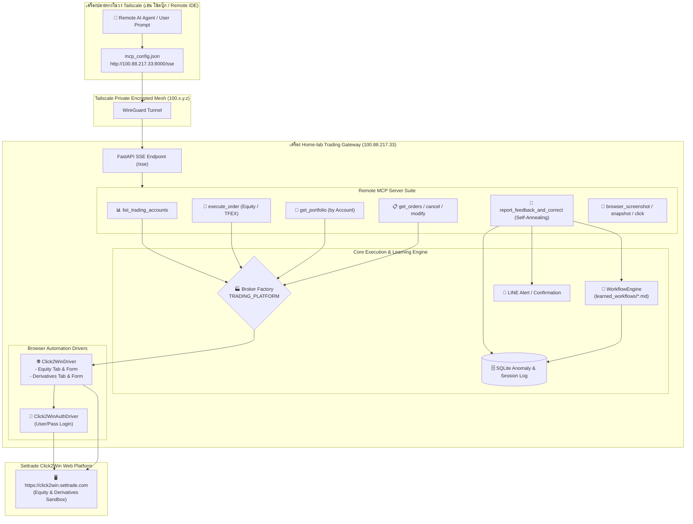
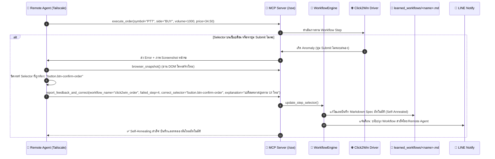

# Click2Win Integration Plan & Remote MCP Self-Annealing Architecture
**เอกสารแผนงานสถาปัตยกรรม: การเชื่อมต่อ Click2Win (หุ้น + อนุพันธ์), การส่งคำสั่งผ่าน Remote MCP (Tailscale) และระบบ Self-Annealing Debugger**

---

## 1. บทนำและเป้าหมายการปรับปรุง (Executive Summary & Objectives)

เอกสารฉบับนี้เป็นการขยายแผนงานจากเดิม เพื่อตอบสนองความต้องการใช้งานจริงผ่านระบบรีโมตในเครือข่าย Tailscale โดยครอบคลุม 4 แกนหลัก:

1. **สลับไปทดสอบบน Settrade Click2Win โดยไม่กระทบ TradeMan เดิม**:
   - ใช้สถาปัตยกรรม **Dual-Driver (Parallel Module)** สลับโหมดด้วย `TRADING_PLATFORM = "CLICK2WIN" | "TRADEMAN"`
   - ล็อกอินด้วย Username + Password โดยตรง ไม่ต้องรอ SMS OTP
2. **รองรับ 2 ประเภทบัญชี: บัญชีหุ้น (Equity) และบัญชีอนุพันธ์ (Derivatives/TFEX)**:
   - ตรวจจับอัตโนมัติจากชื่อ Ticker (เช่น `CPALL` -> หุ้น, `S50M24` -> อนุพันธ์)
   - มีฟังก์ชันค้นหาและคืนค่าบัญชีที่มีอยู่ (`list_trading_accounts`) เพื่อให้ Remote Agent หรือผู้ใช้ทราบเลขบัญชีและวงเงินก่อนส่งคำสั่ง
3. **ส่งคำสั่งเข้า Click2Win Simulation จริง (ตัด DRY_RUN_MODE ออก)**:
   - เนื่องจาก Click2Win เป็น Sandbox จำลองอยู่แล้ว ระบบจะกรอกฟอร์มและกดปุ่ม Submit เพื่อให้ออเดอร์เข้าคิว Match จริงในระบบจำลอง
4. **เปิด Remote MCP Server บนวง Tailscale พร้อมระบบ Self-Annealing Debugging**:
   - เครื่องภายนอกในวง Tailscale (เช่น โน้ตบุ๊ก, Antigravity IDE บนเครื่องอื่น) สามารถสั่งงานผ่าน MCP (`http://100.88.217.33:8000/sse`)
   - **Self-Annealing Loop**: หาก Remote AI หรือผู้ใช้พบว่าคลิกผิดจุด หรือ DOM ของเว็บเปลี่ยน สามารถส่ง Feedback และ Selector ที่ถูกต้องกลับมาผ่าน MCP Tool แล้วระบบจะปรับแก้ไฟล์ Runbook (`learned_workflows/*.md`) ให้อัตโนมัติทันที

---

## 2. แผนภาพสถาปัตยกรรมระบบรวม (End-to-End System Architecture)



---

## 3. การจัดการบัญชีหุ้นและอนุพันธ์ (Dual-Account Management)

ในแพลตฟอร์ม Streaming / Click2Win จะมีแท็บหรือเมนู Dropdown ให้สลับระหว่าง **Equity (หุ้น)** และ **Derivatives (อนุพันธ์ TFEX)**:

### 3.1 โครงสร้างข้อมูลบัญชี (`AccountSummary`)
```python
{
    "accounts": [
        {
            "account_no": "999999-1",
            "account_type": "EQUITY",          # หุ้น (Cash Balance)
            "line_available": 5000000.0,       # วงเงินซื้อ
            "cash_balance": 5000000.0,
            "total_equity": 5000000.0
        },
        {
            "account_no": "999999-2",
            "account_type": "DERIVATIVES",     # อนุพันธ์ (TFEX)
            "line_available": 2000000.0,       # Excess Margin (EE)
            "cash_balance": 2000000.0,
            "total_equity": 2000000.0
        }
    ],
    "active_account": "999999-1"
}
```

### 3.2 กฎการระบุและสลับบัญชี (Routing Strategy)
1. **Auto-Detection จาก Ticker Symbol**:
   - หาก Ticker เป็นหุ้นทั่วไปในกระดาน SET/mai เช่น `PTT`, `CPALL`, `DELTA`, `BBL` -> เลือกระบบบัญชี **EQUITY**
   - หาก Ticker เป็นสัญญาซื้อขายล่วงหน้า เช่น `S50M24`, `S50U24`, `GOH24`, `USDM24` -> เลือกระบบบัญชี **DERIVATIVES**
2. **Explicit Override**:
   - หากผู้ใช้หรือ Remote AI ส่งพารามิเตอร์ `account_type="DERIVATIVES"` หรือ `account_no="999999-2"` ระบบจะบังคับสลับไปยังบัญชีที่ระบุทันที
3. **การสลับแท็บบนหน้าจอ Click2Win Web**:
   - Driver จะตรวจสอบ Dropdown เลขที่บัญชี หรือปุ่มแท็บ `EQUITY` / `DERIVATIVES` บนหน้าจอ Streaming และคลิกเลือกให้ตรงก่อนส่งคำสั่ง

---

## 4. การส่งคำสั่งซื้อขายจริงบน Click2Win (Bypassing DRY_RUN)

- **นโยบาย**: บนบัญชีจริง (TradeMan) จะยังคงใช้ `DRY_RUN_MODE` เพื่อความปลอดภัยสูงสุด แต่สำหรับ **Click2Win**:
  - `DRY_RUN_MODE` จะถูก **Bypass อัตโนมัติ** เนื่องจากยอดเงินทั้งหมด ฿5,000,000 เป็นเงินจำลองในระบบ Sandbox ของตลาดหลักทรัพย์
  - ระบบจะพิมพ์ Symbol, Volume, Price, PIN (ถ้ามี) หน่วงเวลาเหมือนมนุษย์ 1.5 - 2.5 วินาที แล้ว **คลิกปุ่มส่งคำสั่ง (Submit/Confirm)** ทันที
  - ดึงค่า **Order Number** ที่ได้รับจาก Click2Win ส่งกลับไปยัง Remote AI เพื่อยืนยันว่าคำสั่งเข้าสู่ตลาดจำลองเรียบร้อย

---

## 5. รายการ Remote MCP Tools สำหรับ Tailscale

เซิร์ฟเวอร์ MCP ที่รันบน `http://100.88.217.33:8000/sse` จะเพิ่มและอัปเกรด Tools เพื่อให้เครื่องในวง Tailscale เรียกใช้งานได้อย่างสมบูรณ์:

### 5.1 หมวดส่งคำสั่งและจัดการพอร์ต (Trading & Portfolio Tools)

| Tool Name | ความสามารถ | พารามิเตอร์ |
| :--- | :--- | :--- |
| `list_trading_accounts` | ค้นหาและรายงานรายการบัญชีทั้งหมด (Equity & Derivatives) พร้อมวงเงิน Cash และ Line | ไม่มี |
| `execute_order` | ส่งคำสั่งซื้อหรือขาย (BUY / SELL / LONG / SHORT) เข้า Click2Win จริง | `symbol`, `side`, `volume`, `price`, `account_type` (ทางเลือก), `pin` (ทางเลือก) |
| `get_portfolio` | ดึงรายการหุ้นหรือสัญญาอนุพันธ์ที่ถือครอง ต้นทุน ราคาตลาด กำไร/ขาดทุน | `account_type` ("EQUITY" หรือ "DERIVATIVES") |
| `get_open_orders` | ดึงรายการคำสั่งที่รอ Match ในหน้า View Order | `account_type` (ทางเลือก) |
| `cancel_or_modify_order` | ยกเลิกคำสั่ง หรือปรับราคาคำสั่งไปยัง Bid 1 / Offer 1 | `order_no`, `action` ("CANCEL" หรือ "CHANGE_PRICE"), `new_price` |

### 5.2 หมวด Self-Annealing & Remote Debugging Tools

| Tool Name | ความสามารถ | พารามิเตอร์ |
| :--- | :--- | :--- |
| `report_feedback_and_correct` | **(Self-Annealing)** รับ feedback อธิบายข้อผิดพลาด และ Selector ใหม่จาก Remote AI แล้วอัปเดตไฟล์ `learned_workflows/*.md` อัตโนมัติ | `workflow_name`, `failed_step`, `correct_selector`, `action`, `explanation` |
| `browser_snapshot` | อ่าน DOM tree และ CSS Selectors ของหน้าจอ Click2Win ปัจจุบัน เพื่อให้ AI ทำการ Debug | `max_elements` (default: 60) |
| `browser_screenshot` | ถ่ายภาพหน้าจอสด ส่งกลับเป็น URL ในวง Tailscale และ Base64 Image ให้ดูผลทันที | `name` (ทางเลือก) |
| `browser_click` | คลิกองค์ประกอบบนหน้าจอแบบเฉพาะกิจ เพื่อช่วยแก้ปัญหาหน้าจอติดขัด | `selector` |
| `browser_type` | พิมพ์ข้อความลงใน Input element ที่กำหนด | `selector`, `text` |

---

## 6. วงจรการเรียนรู้และปรับตัวเอง (Self-Annealing Learning Loop)



---

## 7. แผนการปรับปรุงโค้ดและส่วนประกอบ (Implementation Plan)

### 7.1 การตั้งค่าระบบ ([app/core/config.py](file:///home/araya-sawasdichai/Documents/antigravity/InvestmentHomelab/app/core/config.py) & [.env.example](file:///home/araya-sawasdichai/Documents/antigravity/InvestmentHomelab/.env.example))
- เพิ่ม:
  ```ini
  TRADING_PLATFORM="CLICK2WIN"  # CLICK2WIN หรือ TRADEMAN
  CLICK2WIN_URL="https://click2win.settrade.com"
  CLICK2WIN_USERNAME=""
  CLICK2WIN_PASSWORD=""
  CLICK2WIN_PIN=""
  CLICK2WIN_SESSION_PATH="data/click2win_session.json"
  ```

### 7.2 Driver & Factory Layer
- **[NEW] [click2win_auth_driver.py](file:///home/araya-sawasdichai/Documents/antigravity/InvestmentHomelab/app/browser/click2win_auth_driver.py)**: ล็อกอินผ่านเว็บ Click2Win ด้วย Username/Password และบันทึก Session Cookie
- **[NEW] [click2win_driver.py](file:///home/araya-sawasdichai/Documents/antigravity/InvestmentHomelab/app/browser/click2win_driver.py)**:
  - สลับแท็บ / Dropdown ระหว่าง **Equity** และ **Derivatives**
  - กวาดข้อมูลพอร์ตทั้งสองบัญชี (`scrape_accounts_summary`, `scrape_portfolio`)
  - คีย์คำสั่งซื้อขายจริง (Submit Button)
  - กวาด View Order และต่อรองราคา (Bid1 / Offer1)
- **[NEW] [broker_factory.py](file:///home/araya-sawasdichai/Documents/antigravity/InvestmentHomelab/app/browser/broker_factory.py)**:
  - `get_broker_driver()` และ `get_auth_driver()` เลือกส่ง `Click2WinDriver` หรือ `TradeManDriver`

### 7.3 Remote MCP Server Layer ([app/mcp/remote_server.py](file:///home/araya-sawasdichai/Documents/antigravity/InvestmentHomelab/app/mcp/remote_server.py))
- เพิ่ม Tool `list_trading_accounts`
- เพิ่ม Tool `execute_order` (ส่งคำสั่งจริงบน Click2Win)
- เพิ่ม Tool `get_portfolio`
- เพิ่ม Tool `get_open_orders`
- เพิ่ม Tool `cancel_or_modify_order`
- เพิ่ม Tool `report_feedback_and_correct` (Self-Annealing Engine)

### 7.4 Workflow Engine ([app/services/workflow_engine.py](file:///home/araya-sawasdichai/Documents/antigravity/InvestmentHomelab/app/services/workflow_engine.py))
- เพิ่มฟังก์ชัน `update_workflow_step(name, step_no, new_selector, explanation)` สำหรับการบันทึกแก้ไขไฟล์ `.md` อัตโนมัติเมื่อได้รับ feedback จาก MCP

---

## 8. แผนการทดสอบและสอบทาน (Verification Plan)

### 8.1 การทดสอบในระดับ Unit & Integration Test (`pytest`)
- รัน `pytest tests/test_click2win_driver.py -v`: ตรวจสอบตรรกะสลับบัญชี Equity/Derivatives และการสร้างออเดอร์
- รัน `pytest tests/test_remote_mcp.py -v`: ตรวจสอบว่า MCP Server มองเห็น Tools ใหม่ทั้งหมด (6 Tools ใหม่)
- ทดสอบ Self-Annealing Engine: ตรวจสอบว่าฟังก์ชัน `update_workflow_step` สามารถอัปเดตเนื้อหาในตาราง Markdown ได้อย่างแม่นยำ

### 8.2 การทดสอบจริงผ่าน Tailscale (End-to-End Test)
1. เปิด Uvicorn บนเครื่อง Home-lab (`http://100.88.217.33:8000`)
2. จากเครื่องปลายทางในวง Tailscale เรียกคำสั่ง MCP:
   - สั่ง `list_trading_accounts` -> ตรวจสอบว่ามองเห็นทั้งบัญชีหุ้นและอนุพันธ์
   - สั่ง `execute_order(symbol="PTT", side="BUY", volume=100, price=34.00, account_type="EQUITY")` -> ตรวจสอบว่าหน้าจอ Click2Win เด้งขึ้นมาคีย์คำสั่งและกดส่งจริง
   - ถ่ายภาพ `browser_screenshot` เพื่อยืนยันหน้าจอหลังส่งคำสั่ง
   - ทดสอบเรียก `report_feedback_and_correct` เพื่อทดสอบระบบ Self-Annealing และยืนยันว่าไฟล์ `.md` ได้รับการปรับปรุง

---
*เอกสารนี้ได้รับการปรับปรุงเพื่อรองรับบัญชีหุ้น/อนุพันธ์, การส่งคำสั่งจริงบน Click2Win, และระบบ Remote MCP Self-Annealing ครบถ้วนตามผลการสัมภาษณ์ `/grill-me`*
