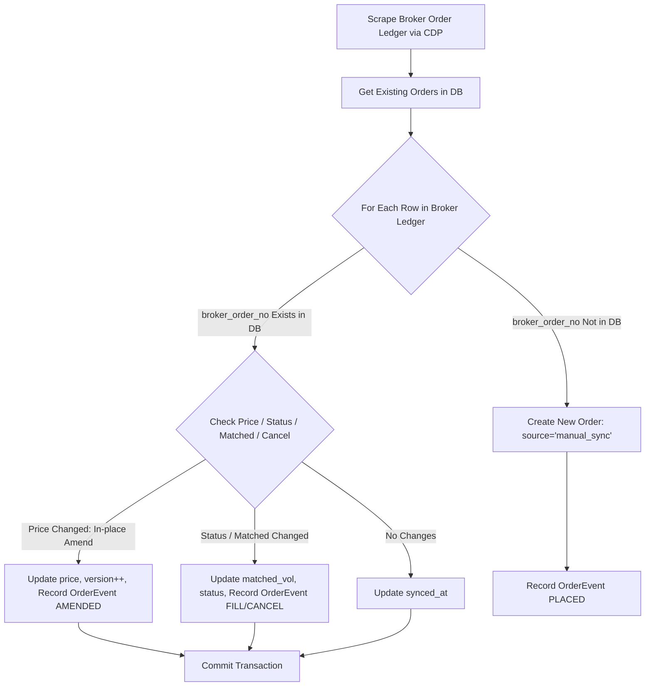

# Architecture & Technical Design: Order State Synchronization & DB Design

**Task ID:** `t_f22dbda2`  
**Author:** Architect / System Planner  
**Date:** 2026-10-29  
**Status:** PROPOSED (Ready for Review & Implementation)  

---

## 1. Executive Summary & Problem Statement

ระบบ InvestmentHomelab ทำงานร่วมกับ 2 โบรกเกอร์หลัก:
1. **Settrade Streaming (Krungsri - KSS)** (Margin 3024959 + Cash 3024952)
2. **Liberator WebTrade (LIB)** (Cash Balance 70559382)

### ข้อจำกัดและ Pain Points ในปัจจุบัน:
- **Human-in-the-loop / Multi-channel Actions**: User สามารถวาง, แก้ไข (Amend), หรือยกเลิก (Cancel) ออเดอร์ได้โดยตรงผ่านแอปพลิเคชันมือถือหรือเว็บของโบรกเกอร์ โดยไม่ได้ผ่าน Homelab
- **In-place Amend Support**: ทั้ง KSS (`PATCH .../orders/{orderNo}/change`) และ Liberator (`#OrderTableList` overlay amend) รองรับการต่อราคา/แก้ไขออเดอร์โดยยังคง `broker_order_no` เดิม ไม่ได้ทำการ Cancel แล้ว Replace ใหม่
- **Current Sync Gap**: ฟังก์ชัน `sync_orders_from_cdp()` ใน `app/services/broker_cdp/sync_service.py` ปัจจุบันมีเงื่อนไข `if not bno or bno in existing: continue` ทำให้:
  1. เมื่อออเดอร์เดิมเปลี่ยนสถานะ (เช่น Match, Partial Match, หรือ Cancelled นอกระบบ) Local DB **ไม่ได้รับการอัปเดตเลย**
  2. เมื่อออเดอร์เดิมถูกแก้ไขราคา In-place amend ในตลาด ข้อมูลใน DB จะกลายเป็นข้อมูลเก่า (Stale Price) เกิด State Drift ทันที

---

## 2. Comparison: 3 Architectural Models

| มิติการเปรียบเทียบ | 1. Direct Broker Read (Stateless) | 2. Local DB Mirror / Cache | 3. Hybrid Model (Recommended) |
|---|---|---|---|
| **Source of Truth** | หน้าจอ / REST API โบรกเกอร์สด 100% | Local SQLite (`orders` table) | **Broker Ledger = Truth**, Local DB = Audit & Verified Cache |
| **Latency (Query)** | สูง (100–350 ms ผ่าน CDP / JS evaluate) | ต่ำมาก (< 1 ms ผ่าน SQLite query) | ทันที (< 1 ms สำหรับ cache), 150-250 ms ตอน sync |
| **State Drift Risk** | **ไม่มี** (ได้ข้อมูลจริงจากตลาดเสมอ) | **สูงมาก** (ถ้า User กดยกเลิกในแอป จะเกิด Ghost Order) | **ต่ำมาก** (มี Two-way Reconciliation คอย Sync & Self-heal) |
| **In-place Amend Handling** | อ่านค่าใหม่ได้ทันที แต่ไม่รู้ประวัติเดิมว่าแก้จากราคาใด | เสี่ยงข้อมูลเพี้ยน หรือเกิด Duplicate ID | **ดีเยี่ยม** (บันทึก Versioning & State Transition Log) |
| **ความพร้อมเมื่อ Session หลุด** | ❌ ใช้งานไม่ได้ (LINE bot แจ้ง session หลุด) | ⚠️ แสดงข้อมูลเก่าได้ แต่อาจผิดพลาด | ✅ แสดงข้อมูลล่าสุดพร้อม Flag `Stale` อย่างซื่อสัตย์ |
| **Audit Trail & Reporting** | ❌ ไม่มีประวัติย้อนหลัง (EOD หายหมด) | ⚠️ มีแต่สถานะล่าสุด ไม่มี History change | ✅ มีตาราง `order_events` บันทึกประวัติครบถ้วน |

### สรุปคำแนะนำทางสถาปัตยกรรม (Architectural Decision):
**เลือก Model 3: Hybrid Model (Broker as Source of Truth + Reconciled Audit Cache)**
- ในจังหวะ Execution (ส่งคำสั่ง / ต่อราคา): ตรวจสอบสถานะจริงจาก Broker เสมอ (Anti-Mock)
- ในจังหวะ Read/Query ทั่วไป (เช่น สรุปพอร์ตย้อนหลัง, คำนวณความเสี่ยง): อ่านจาก Local DB Cache เพื่อความรวดเร็ว
- ในจังหวะ Triggered Sync (`/orders <broker> sync` หรือ Post-trade hook): รัน Two-way Reconcile เพื่อดึงสถานะจริงมาทับ DB พร้อมบันทึก Audit Event

---

## 3. Database Schema Design (SQLite / SQLAlchemy)

### 3.1 Update Table `orders` (Enhancement)
ปรับปรุง `app/db/models.py` เพื่อรองรับ In-place Amend, Multi-account, และ Reconcile tracking:

```python
class Order(Base):
    __tablename__ = "orders"

    order_id: Mapped[str] = mapped_column(String(64), primary_key=True, index=True) # e.g. "CDP-KSS-3024959-11009293"
    broker_order_no: Mapped[Optional[str]] = mapped_column(String(64), nullable=True, index=True)
    broker: Mapped[str] = mapped_column(String(32), nullable=False, index=True)      # "KRUNGSRI" / "LIBERATOR"
    account_no: Mapped[Optional[str]] = mapped_column(String(32), nullable=True, index=True)
    
    symbol: Mapped[str] = mapped_column(String(16), nullable=False, index=True)
    side: Mapped[str] = mapped_column(String(16), nullable=False)                    # BUY, SELL, SHORT, COVER
    position: Mapped[Optional[str]] = mapped_column(String(16), nullable=True)       # OPEN, CLOSE, AUTO
    
    volume: Mapped[int] = mapped_column(Integer, nullable=False)                    # Original/Current total order volume
    price: Mapped[float] = mapped_column(Float, nullable=False)                      # Current effective price
    
    matched_volume: Mapped[int] = mapped_column(Integer, default=0, nullable=False)
    matched_price: Mapped[Optional[float]] = mapped_column(Float, nullable=True)
    cancel_volume: Mapped[int] = mapped_column(Integer, default=0, nullable=False)
    
    status: Mapped[str] = mapped_column(String(32), nullable=False, default="PENDING", index=True)
    # Status: PENDING, SUBMITTED, OPEN, PARTIAL, MATCHED, CANCELLED, REJECTED, UNCONFIRMED, EXPIRED_EOD
    
    # In-place Amend & Lifecycle Tracking
    version: Mapped[int] = mapped_column(Integer, default=1, nullable=False)         # Increments on each in-place amend
    is_negotiated: Mapped[bool] = mapped_column(Boolean, default=False)
    original_price: Mapped[Optional[float]] = mapped_column(Float, nullable=True)     # Initial price before any amends
    last_amended_price: Mapped[Optional[float]] = mapped_column(Float, nullable=True) # Previous price before latest amend
    
    source: Mapped[str] = mapped_column(String(32), default="bot_cdp")            # bot_cdp, manual_sync, line_cli, autotrade
    error_message: Mapped[Optional[Text]] = mapped_column(Text, nullable=True)
    
    created_at: Mapped[datetime] = mapped_column(DateTime, default=func.now(), nullable=False)
    updated_at: Mapped[datetime] = mapped_column(DateTime, default=func.now(), onupdate=func.now(), nullable=False)
    synced_at: Mapped[Optional[datetime]] = mapped_column(DateTime, nullable=True)   # Timestamp of last broker confirmation
```

### 3.2 New Table `order_events` (Audit Trail & Change Log)
เก็บบันทึกประวัติการเปลี่ยนสถานะและราคาเพื่อป้องกัน State Drift และตรวจย้อนหลัง:

```python
class OrderEvent(Base):
    __tablename__ = "order_events"

    id: Mapped[int] = mapped_column(Integer, primary_key=True, autoincrement=True)
    order_id: Mapped[str] = mapped_column(String(64), ForeignKey("orders.order_id"), index=True, nullable=False)
    broker_order_no: Mapped[Optional[str]] = mapped_column(String(64), nullable=True, index=True)
    
    event_type: Mapped[str] = mapped_column(String(32), nullable=False) 
    # e.g. PLACED, IN_PLACE_AMENDED, PARTIAL_FILL, FULL_FILL, CANCELLED, RECONCILE_DRIFT_FIX
    
    old_price: Mapped[Optional[float]] = mapped_column(Float, nullable=True)
    new_price: Mapped[Optional[float]] = mapped_column(Float, nullable=True)
    old_status: Mapped[Optional[str]] = mapped_column(String(32), nullable=True)
    new_status: Mapped[Optional[str]] = mapped_column(String(32), nullable=True)
    matched_delta: Mapped[int] = mapped_column(Integer, default=0, nullable=False)
    
    raw_payload: Mapped[Optional[Text]] = mapped_column(Text, nullable=True) # JSON snapshot of broker row
    triggered_by: Mapped[str] = mapped_column(String(32), default="system")  # line_nego, manual_sync, cron, cdp_exec
    created_at: Mapped[datetime] = mapped_column(DateTime, default=func.now(), nullable=False)
```

---

## 4. Order State Synchronization Engine (Two-Way Reconciler)

### 4.1 Sync Logic Workflow
เมื่อฟังก์ชัน `sync_orders_from_cdp(broker, db)` ถูกเรียก (ทั้งจาก `/orders [kss|lib] sync` หรือ background tick):



### 4.2 Handling In-place Amend Without Phantom Orders
1. **Natural Key Idempotency**: ยึดคู่ `(broker, account_no, broker_order_no)` เป็น Natural Key เสมอ ห้าม generate `order_id` ใหม่เมื่อมีการแก้ราคา
2. **Version Bump**: เมื่อตรวจพบว่า `live_price != db_order.price` ให้:
   - บันทึก `db_order.last_amended_price = db_order.price`
   - อัปเดต `db_order.price = live_price`
   - เพิ่ม `db_order.version += 1`
   - สร้าง `OrderEvent` ประเภท `IN_PLACE_AMENDED`
3. **Closed Queue Detection**: หากออเดอร์ใน DB มีสถานะ `OPEN` หรือ `PARTIAL` แต่ไม่ปรากฏใน Open Ledger ของโบรกเกอร์แล้ว:
   - ให้ Re-query Closed/History Ledger ของวันนั้น
   - หากพบว่า Matched ครบ -> ปรับเป็น `MATCHED`
   - หากพบว่า Cancel -> ปรับเป็น `CANCELLED`
   - หากไม่พบในวันเดียวกัน (EOD Expired) -> ปรับเป็น `EXPIRED_EOD`

---

## 5. Granular Sub-Task Implementation Breakdown

ตามรูปแบบการพัฒนาของ Homelab แบ่งงานเป็นรายข้อย่อย 4 ขั้นตอน:

### Sub-task 1.1: Database Model & Migration (`app/db/models.py`)
- **Tier / Model:** T0 (`gemini-3.8-flash`)
- **Files:** `app/db/models.py`, `tests/test_order_models.py`
- **Scope:**
  - เพิ่ม columns: `version`, `last_amended_price`, `synced_at` ใน `Order`
  - เพิ่มตาราง `OrderEvent` พร้อม foreign key และ indexes
- **Verification:** Unit test migration / SQLAlchemy Base.metadata.create_all() บน SQLite memory DB
- **Done When:** Unit test ผ่าน 100%, สร้างและ query relations ได้สมบูรณ์

### Sub-task 1.2: Two-way Reconciler Engine (`app/services/broker_cdp/sync_service.py`)
- **Tier / Model:** T1 (`gemini-3.1-pro`)
- **Files:** `app/services/broker_cdp/sync_service.py`, `tests/test_broker_cdp_order_sync.py`
- **Scope:**
  - ปรับปรุง `sync_orders_from_cdp()` ให้รองรับการอัปเดต existing orders (สถานะเปลี่ยน, matched volume เพิ่ม, in-place price amend)
  - เพิ่ม helper `_reconcile_single_order(session, db_order, live_row)`
  - บันทึก `OrderEvent` ลงฐานข้อมูลเมื่อเกิดการเปลี่ยนแปลง
- **Verification:** เขียน mock unit tests ครอบคลุม: New manual order, In-place price change, Partial match update, Full match, Cancelled
- **Done When:** `pytest tests/test_broker_cdp_order_sync.py` ผ่านครบทุก edge case

### Sub-task 1.3: LINE CLI Integration & Display Enhancement
- **Tier / Model:** T0 (`gemini-3.8-flash`)
- **Files:** `app/services/line_cli/handlers.py`, `tests/test_line_cli_orders.py`
- **Scope:**
  - ปรับปรุงคำสั่ง `/orders [kss|lib] sync` ให้เรียก Two-way sync และแสดงผลสรุปว่ามีออเดอร์ใหม่กี่รายการ, อัปเดตสถานะ/ราคาเดิมกี่รายการ
  - เพิ่ม badge แสดงออเดอร์ที่ถูกต่อราคา เช่น `[⚡ v2: 12.50]` ใน Flex Card
- **Verification:** รัน unit test ทดสอบ handler response ของ `/orders lib sync` และ `/orders kss sync`
- **Done When:** Test suite ของ LINE CLI orders ผ่านครบถ้วน

### Sub-task 1.4: Real Broker CDP In-place Amend Witness (T2 + Human)
- **Tier / Model:** T2 (`gemini-3.8-flash` + Human Witness)
- **Files:** `docs/handoff/TASK-witness-order-sync.md`
- **Scope:**
  - วาง Limit order 100 หุ้นราคาต่ำกว่าตลาดบน Liberator / Streaming
  - ทำการต่อราคา (In-place amend) ผ่าน Web/App มือถือ
  - สั่ง `/orders [broker] sync` ผ่าน LINE CLI และตรวจเช็คว่า Local DB อัปเดตราคาใหม่ทันทีโดยไม่สร้าง Order ID ใหม่ และมีบันทึกใน `order_events`
- **Verification:** Screenshot หลักฐานหน้าจอ + SQLite query log
- **Done When:** Human witness เซ็นรับรองว่าไม่มี Phantom Order และ State สอดคล้อง 100%

---

## 6. Verification Plan & Rollback Strategy

1. **Pre-flight Check**: รัน `scripts/verify_changes.py` ตรวจสอบ lint และ unit tests
2. **Safe Migration**: SQLite schema additive only (เพิ่ม nullable columns และ new table ไม่ทำลาย schema เดิม)
3. **Rollback**: หาก Reconciler มีปัญหา สามารถ flag fallback กลับไปใช้โหมดเดิม (`INSERT ONLY`) ผ่าน config `SETTINGS.ORDER_SYNC_RECONCILE_ENABLED = False` ได้ทันที
