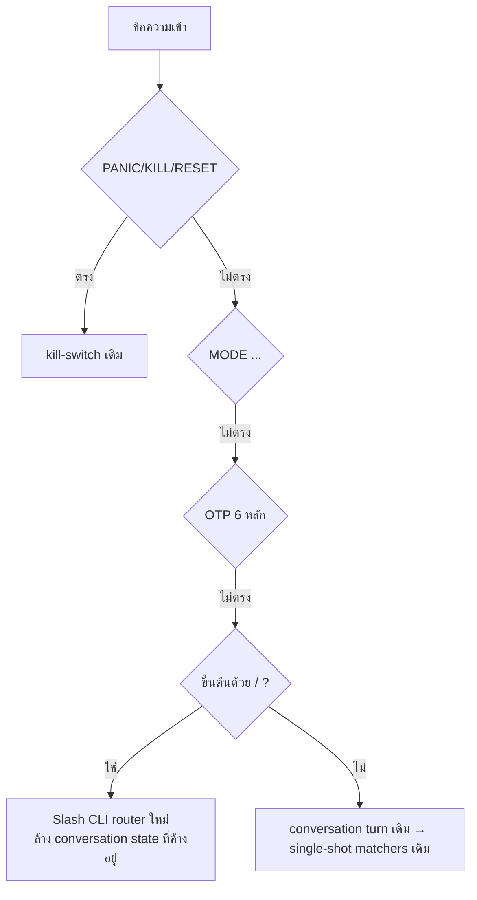

# LINE CLI Command — Design Spec (Pillar 1–3, KSS + LIB)

ออกแบบชุดคำสั่ง `/…` ผ่าน LINE (กลุ่ม OTP relay + แชท 1:1 กับ OA) สำหรับ Krungsri TradeMan (`kss`) และ Liberator (`lib`) เท่านั้น — **ยังเป็น design เท่านั้น ยังไม่ implement**

## สรุปการตัดสินใจ (grill-me)

| # | เรื่อง | ข้อสรุป |
|---|---|---|
| Q1 | Syntax | prefix `/` + verb ภาษาอังกฤษสั้น · รับ Thai alias · ไม่สนตัวพิมพ์เล็ก/ใหญ่ |
| Q2 | Broker | loop นี้มีแค่ `kss`, `lib` (+ `all` สำหรับคำสั่งอ่าน/login) |
| Q3 | Login | เช็ค session ก่อน · ถ้ายัง alive ไม่ login ซ้ำ · `force` = บังคับเข้าใหม่ · OTP ใช้ relay ที่มีอยู่ |
| Q4 | Portfolio | อ่าน DB snapshot เป็นค่าเริ่มต้น · ต่อท้าย `sync` = scrape สด (เฉพาะตอน session ยัง alive) |
| Q5 | ส่งออเดอร์ใหม่ | **ยังไม่ทำใน loop นี้** (`/buy` `/sell` `/cancel` `/amend` ไม่มี) |
| Q6 | `/nego` | ทำทันทีไม่ต้องกดอนุมัติ · ใช้ได้ทั้ง kss/lib · มี guardrail 6 ข้อ |
| Q7 | คำสั่งในชุดนี้ | `/status` `/login` `/logout` `/port` `/cash` `/orders` `/nego` `/help` |
| Q8 | รูปแบบข้อความตอบ | Flex Message (การ์ด) สำหรับข้อมูล · ข้อความธรรมดาสำหรับการรับทราบ/error |

## ต้องให้ผู้ใช้ตรวจ

> [!CAUTION]
> `/nego` **แก้ราคาออเดอร์จริงโดยไม่ต้องกดอนุมัติ** (แก้ในที่เดิม ไม่ยกเลิก) ตอน `MODE LIVE` — การพิมพ์คำสั่งเองถือว่าเป็นคำขอชัดเจน แต่ก็มีโอกาสพิมพ์ผิดหรือส่งข้อความซ้ำ guardrail ข้างล่างจึงจำเป็นทุกข้อ ช่วยยืนยันค่า `N = 3 tick` และช่วงเวลาที่อนุญาต

> [!IMPORTANT]
> ตามกฎ Broker isolation: KSS ใช้ `trademan_driver.modify_order_price` ส่วน LIB ใช้ `liberator.negotiate_price/change_order` — ไม่ใช้ logic ข้ามโบรกเกอร์กัน

## คำถามที่ยังเปิดอยู่

1. `/nego` ไม่ระบุตัวหุ้น = ต่อราคา**ทุก**ออเดอร์ที่ค้างของโบรกเกอร์นั้น — ควรตั้งเพดานจำนวนออเดอร์ต่อครั้งไหม (เสนอ: สูงสุด 10)
2. `/logout all` ระหว่างที่ scheduler กำลังรันรอบ Auto Trade อยู่ — จะยอมให้ทำไหม (เสนอ: ยอม แต่เตือนว่ามีรอบที่ใกล้จะรันใน 15 นาที)
3. `/status` จะให้แสดงเฉพาะ kss/lib หรือแสดง Click2Win/Settrade เป็นสถานะ "ไม่อยู่ในขอบเขต" ด้วย (เสนอ: kss/lib เท่านั้น)

---

## 1. ไวยากรณ์ทั่วไป

```
/<command> [broker] [target] [flag]
broker := kss | lib | all          (alias: krungsri/กรุงศรี → kss, liberator/ลิเบอเรเตอร์ → lib, ทั้งหมด → all)
flag   := sync | force
```

- เติม `/` ข้างหน้าเสมอ (มี `/` ถึงจะเข้า router นี้) → ไม่ชนกับ AI parser ที่จับคำว่า `SELL`/`ขาย` และไม่ชน flow `symbol_query`
- ไม่สนตัวพิมพ์เล็ก/ใหญ่ ยุบช่องว่างซ้ำให้เหลือช่องเดียว ยอมรับ `／` (slash แบบ full-width จากคีย์บอร์ดมือถือ)
- ไม่ระบุ broker: คำสั่งอ่าน = `all` · `/login` `/logout` `/nego` = **ต้องระบุ** (ถ้าไม่ระบุ ตอบเป็นปุ่มให้เลือก)
- พิมพ์คำสั่งไม่รู้จัก → ตอบว่า "ไม่รู้จักคำสั่ง" + เสนอคำสั่งที่ใกล้เคียง (Levenshtein ≤ 2) + ปุ่ม `/help`

### ลำดับการ route ใน `_handle_text_message`



- Slash router อยู่ **หลัง** kill-switch/MODE/OTP (การหยุดฉุกเฉินชนะเสมอ OTP ไม่ถูกกลืน) และ **ก่อน** conversation flow (คำสั่ง `/` ยกเลิก flow ที่ค้างอยู่)
- Authorization = Decision A เดิม (`LINE_SIMULATION_MODE` หรือ `groupId == LINE_GROUP_ID` หรือแชท 1:1) · ถ้าไม่ผ่าน → `⛔ ไม่มีสิทธิ์ใช้คำสั่งนี้จากห้องนี้`

### งานที่ใช้เวลานาน (login / sync / nego)

reply token ของ LINE หมดอายุเร็ว → **ตอบรับทราบ (ack) ทันทีด้วย reply** แล้ว**ส่งผลลัพธ์ด้วย push** ไปที่ห้องเดิม (`groupId` หรือ `userId`)
- มี lock ต่อ `(command, broker)`: ถ้าส่งคำสั่งเดิมซ้ำระหว่างที่ยังทำอยู่ → `⏳ /nego kss กำลังทำงานอยู่ (เริ่ม 10:42:05) — รอผลสักครู่`

---

## 2. ตารางคำสั่ง

| คำสั่ง | Thai alias | Pillar | ผลข้างเคียง | ต้องให้ session alive |
|---|---|---|---|---|
| `/help [cmd]` | `/ช่วย` `/คำสั่ง` | – | ไม่มี | ไม่ |
| `/status [kss\|lib\|all]` | `/สถานะ` | 1 | ไม่มี (อ่านจาก DB/หน่วยความจำ) | ไม่ |
| `/login kss\|lib\|all [force]` | `/ล็อกอิน` `/เข้าระบบ` | 1 | อาจส่ง SMS OTP | – |
| `/logout kss\|lib\|all` | `/ออกระบบ` | 1 | ปิด browser session | ไม่ |
| `/port [kss\|lib\|all] [sync]` | `/พอร์ต` | 2 | `sync` = scrape | เฉพาะ `sync` |
| `/cash [kss\|lib\|all] [sync]` | `/เงิน` `/วงเงิน` | 2 | `sync` = scrape | เฉพาะ `sync` |
| `/orders [kss\|lib\|all] [sync]` | `/ออเดอร์` `/คำสั่งค้าง` | 2/3 | `sync` = scrape | เฉพาะ `sync` |
| `/nego kss\|lib [SYMBOL\|order_no]` | `/ต่อราคา` | 3 (Pillar 6 tool) | **แก้ราคาออเดอร์จริง** | ใช่ |

คำสั่ง legacy ที่ยังเหมือนเดิม: `PANIC/KILL`, `RESET`, `MODE [TEST|LIVE <PIN>]`, `action`, `set`, `schedule`, `QUERY <SYM>`

---

## 3. รายละเอียดคำสั่ง + ข้อความตอบ

สัญลักษณ์: 🟢 alive · 🟡 กำลังเข้าระบบ/รอ OTP · 🔴 หลุด · ⚪ ไม่เคยเข้าระบบ · badge `[TEST]`/`[LIVE]` จาก `trade_dispatcher.get_mode_badge()`

### 3.1 `/help`

```
📖 คำสั่ง Homelab (KSS / LIB)
Pillar 1 · Session
  /status [kss|lib]        สถานะระบบ
  /login kss|lib|all [force]
  /logout kss|lib|all
Pillar 2 · Portfolio
  /port [kss|lib] [sync]   หุ้นที่ถือ + P/L
  /cash [kss|lib] [sync]   เงินสด / กำลังซื้อ
  /orders [kss|lib] [sync] ออเดอร์วันนี้
Pillar 3 · Trade
  /nego kss|lib [SYM|เลขออเดอร์]  ต่อราคาไป Bid1/Offer1
ฉุกเฉิน: PANIC · RESET · MODE
พิมพ์ /help nego เพื่อดูรายละเอียด
```
Quick Reply: `[/status] [/port] [/orders]`

`/help nego` → อธิบาย syntax + guardrail ทั้ง 6 ข้อ (ข้อ 3.8) เป็นข้อความธรรมดา

### 3.2 `/status` — Flex การ์ด "System Status"

```
┌ 🛰️ Homelab Status            [LIVE] ┐
│ Kill-switch   🟢 ปกติ               │
│ OTP relay     🟢 พร้อม (กลุ่ม a14s) │
├──────────────────────────────────────┤
│ KSS  🟢 alive   heartbeat 10:41     │
│      บัญชี MARGIN · หมดอายุ ~13:10  │
│ LIB  🔴 หลุด    ล่าสุด 09:58        │
│      CASH                            │
├──────────────────────────────────────┤
│ อัปเดต 10:42:07                      │
└ [🔑 /login lib] [📊 /port]          ┘
```
- ปุ่มใน footer แสดงตามสถานะ (ถ้ามีตัวไหนหลุด → แสดงปุ่ม `/login <ตัวนั้น>`)
- altText: `Homelab: KSS🟢 LIB🔴 · relay🟢 · LIVE`
- Kill-switch active → ทั้งหัวการ์ดเป็นสีแดง + `⛔ KILL-SWITCH ACTIVE — พิมพ์ RESET เพื่อปลด`

### 3.3 `/login kss|lib|all [force]`

ลำดับการทำงาน (ต่อ broker):
1. kill-switch active → ปฏิเสธ
2. session alive และไม่มี `force` → `🟢 KSS เชื่อมต่ออยู่แล้ว (heartbeat 10:41) — ใช้ /login kss force เพื่อเข้าใหม่`
3. `otp_relay_readiness.check().ready != true` → **ไม่ยิง SMS** (Invariant 9) → `🚫 OTP relay ยังไม่พร้อม: <เหตุผล> — ยังไม่ส่ง SMS`
4. ack: `🔐 กำลังเข้าระบบ KSS… เมื่อได้ SMS ให้พิมพ์ OTP 6 หลักในกลุ่มนี้ (หมดเวลาใน 3 นาที)`
5. push ผลลัพธ์:
   - สำเร็จ: `✅ KSS เข้าระบบสำเร็จ (บัญชี MARGIN) · 10:43:20` + Quick Reply `[/port kss] [/orders kss]`
   - OTP หมดเวลา: `⌛ KSS รอ OTP เกิน 3 นาที — ยกเลิกแล้ว พิมพ์ /login kss เพื่อลองใหม่`
   - OTP ผิด: `❌ KSS OTP ไม่ถูกต้อง (Ref: AB12) — พิมพ์ /login kss เพื่อขอรหัสใหม่`
   - ล้มเหลวอื่นๆ: `❌ KSS เข้าระบบไม่สำเร็จ: <error จริง>` (ห้ามรายงานว่าสำเร็จถ้าไม่สำเร็จจริง — Anti-Mock)
- `all` = ทำทีละตัวตามลำดับ (kss → lib) เพราะ OTP relay ใช้กติกา latest-request-wins → **ห้ามขอ OTP 2 โบรกเกอร์พร้อมกัน**; ack จะบอก `ลำดับ: KSS → LIB`

### 3.4 `/logout kss|lib|all`

- `👋 ออกจากระบบ KSS แล้ว (ปิด browser session)`
- ถ้ายังไม่ได้เข้าระบบ: `⚪ KSS ไม่ได้เข้าระบบอยู่แล้ว`
- ถ้ามีรอบ scheduler ที่จะรันใน 15 นาที (คำถามเปิดข้อ 2): ต่อท้าย `⚠️ รอบ Auto Trade 11:05 จะต้อง login ใหม่`

### 3.5 `/port [kss|lib|all] [sync]` — Flex carousel (1 bubble ต่อ broker)

```
┌ 📊 KSS · MARGIN               [LIVE] ┐
│ มูลค่ารวม   1,254,300.00             │
│ P/L วันนี้   +12,450.00 (+1.00%) 🟢  │
├──────────────────────────────────────┤
│ หุ้น    จำนวน   ทุน    ล่าสุด   %P/L │
│ PTT    5,000  33.75  34.25  +1.48 🟢│
│ AOT    2,000  62.00  60.50  -2.42 🔴│
│ AP⇣S   3,000   8.20   8.05  +1.83 🟢│  ← SHORT/SBL มีป้ายกำกับ
│ …และอีก 4 ตัว                         │
├──────────────────────────────────────┤
│ 🕒 snapshot 10:15 (27 นาทีก่อน)       │
└ [🔄 /port kss sync] [📋 /orders kss] ┘
```
- แสดงสูงสุด 10 แถว เรียงตามมูลค่า ตัวที่เกินแสดงเป็น "…และอีก N ตัว"
- snapshot เก่ากว่า 60 นาที → ตัวอักษรเวลาเป็นสีเหลือง + `⚠️ ข้อมูลเก่า`
- ไม่มีข้อมูลใน DB → `ℹ️ ยังไม่มี snapshot ของ KSS — ใช้ /port kss sync` (ห้ามแสดงพอร์ตว่างแล้วบอกว่าสำเร็จ)
- `sync` + session หลุด → `🔴 KSS session หลุด — /login kss ก่อน แล้วค่อย sync` (**ไม่ login เอง** — Invariant 7)
- `sync` ปกติ: ack `🔄 กำลังดึงข้อมูลสด KSS…` → push การ์ด (เวลาเป็น `🟢 live 10:43`)

### 3.6 `/cash [kss|lib|all] [sync]` — Flex bubble

```
┌ 💰 KSS · MARGIN                      ┐
│ เงินสด / Cash balance    250,000.00  │
│ กำลังซื้อ / Buying power  480,000.00  │
│ วงเงินเครดิต               1,000,000  │
│ Margin call               ไม่มี 🟢    │
│ 🕒 snapshot 10:15                     │
└ [🔄 /cash kss sync]                  ┘
```
- LIB: แสดง `CASH (บัญชีเดียว)` ไม่มีแถว margin

### 3.7 `/orders [kss|lib|all] [sync]` — Flex bubble

```
┌ 📋 KSS ออเดอร์วันนี้ (3 ค้าง / 5 ทั้งหมด) ┐
│ #12345 BUY  PTT   1,000 @34.00  ⏳ ค้าง 1,000 │
│ #12346 SELL AOT     500 @61.00  ⏳ ค้าง   200 │
│ #12347 SHORT AP   3,000 @8.25   ⏳ ค้าง 3,000 │
│ #12340 BUY  CPALL   100 @55.50  ✅ ครบ        │
│ #12341 SELL KBANK   100 @140.0  ✖ ยกเลิก     │
│ 🕒 snapshot 10:40                            │
└ [⚡ /nego kss] [🔄 /orders kss sync]        ┘
```
- ปุ่ม `/nego kss` แสดงเฉพาะเมื่อมีออเดอร์ค้าง ≥ 1 และอยู่ในเวลาตลาด

### 3.8 `/nego kss|lib [SYMBOL|order_no]` — ทำทันที

**การเลือกเป้าหมาย**
- ไม่ระบุ → ทุกออเดอร์ที่ค้าง (`balance > 0`, ไม่ใช่ Matched/Cancelled) ของโบรกเกอร์นั้น (เพดานตามคำถามเปิดข้อ 1)
- `SYMBOL` (ตัวอักษร) → ทุกออเดอร์ค้างของหุ้นนั้น · `order_no` (ตัวเลขล้วน) → ออเดอร์นั้นตัวเดียว

**ราคาเป้าหมาย**: BUY → Bid1 · SELL/COVER → Offer1 · SHORT → Offer1 (ต้องผ่าน uptick) · แก้ในที่เดิม (คิวเดิม ไม่ cancel+place ใหม่)

**Guardrails (ต้องผ่านทุกข้อ ต่อออเดอร์)**

| # | เงื่อนไข | ถ้าไม่ผ่าน |
|---|---|---|
| G1 | kill-switch ไม่ active | ปฏิเสธทั้งคำสั่ง |
| G2 | อยู่ในเวลาที่อนุญาต (เสนอ 09:55–12:30, 14:25–16:30 ปรับได้ใน config) | ปฏิเสธทั้งคำสั่ง |
| G3 | session alive (ห้าม login เอง) | ปฏิเสธทั้งคำสั่ง → แนะนำ `/login` |
| G4 | ราคาใหม่ผ่าน SET tick-size validator | ข้ามออเดอร์นั้น |
| G5 | `|ราคาใหม่ − ราคาเดิม| ≤ N tick` (N=3, `LINE_NEGO_MAX_TICKS`) | ข้าม + แจ้งว่าห่างกี่ tick |
| G6 | SHORT ต้องไม่ผิด uptick rule | ข้าม + แจ้ง |
| – | ราคาเดิม = ราคาเป้าหมายอยู่แล้ว | ข้าม (`อยู่ที่ Bid1 แล้ว`) |

**ข้อความ**
- ack: `⚡ [LIVE] กำลังต่อราคา KSS · 3 ออเดอร์ค้าง…`
- push ผลลัพธ์ (Flex):

```
┌ ⚡ ผลต่อราคา KSS            [LIVE] ┐
│ ✅ #12345 BUY PTT   34.00 → 34.25   │
│ ⏭️ #12346 SELL AOT  61.00 (Offer1=60.25, ห่าง 3+ tick เกิน N=3) │
│ ⏭️ #12347 SHORT AP  ผิด uptick       │
├──────────────────────────────────────┤
│ สำเร็จ 1 · ข้าม 2 · ล้มเหลว 0          │
│ 🕒 10:44:02                           │
└ [📋 /orders kss sync]                ┘
```
- ล้มเหลวจาก broker: `❌ #12345 PTT: <ข้อความ error จริงจาก broker>`
- ไม่มีออเดอร์ค้าง: `ℹ️ KSS ไม่มีออเดอร์ค้างให้ต่อราคา`
- ไม่พบเป้าหมาย: `❓ ไม่พบออเดอร์ค้างของ PTT ใน KSS`
- `MODE TEST` → ทำบน simulator + การ์ดมีป้าย `[TEST] จำลอง — ไม่ได้ส่งจริง`
- Audit: บันทึก `SessionLog(event_type="LINE_CLI_NEGO", details=…)` ทุกออเดอร์ (ส่ง / ข้าม / ล้มเหลว)

---

## 4. รายการ Error ที่ใช้ร่วมกัน

| รหัส | ข้อความ |
|---|---|
| `E_UNKNOWN_CMD` | `❓ ไม่รู้จักคำสั่ง "/prot" — หมายถึง /port ? · พิมพ์ /help` |
| `E_BAD_BROKER` | `❓ ไม่รู้จักโบรกเกอร์ "c2w" — loop นี้รองรับ kss, lib` |
| `E_BROKER_REQUIRED` | `เลือกโบรกเกอร์สำหรับ /nego:` + Quick Reply `[kss] [lib]` |
| `E_UNAUTHORIZED` | `⛔ ไม่มีสิทธิ์ใช้คำสั่งนี้จากห้องนี้` |
| `E_KILL_SWITCH` | `⛔ KILL-SWITCH ACTIVE — คำสั่งถูกระงับ · พิมพ์ RESET เพื่อปลด` |
| `E_SESSION_DOWN` | `🔴 <BROKER> session หลุด — /login <broker> ก่อน` |
| `E_RELAY_NOT_READY` | `🚫 OTP relay ยังไม่พร้อม: <reason> — ยังไม่ส่ง SMS` |
| `E_OUT_OF_HOURS` | `🌙 นอกเวลาที่อนุญาต (09:55–12:30, 14:25–16:30)` |
| `E_BUSY` | `⏳ /<cmd> <broker> กำลังทำงานอยู่ (เริ่ม HH:MM:SS)` |
| `E_INTERNAL` | `⚠️ เกิดข้อผิดพลาด: <ข้อความสั้น> (ref: <log id>)` — ห้ามแสดง credentials/stacktrace |

---

## 5. เสนอโครงสร้างโค้ดสำหรับ loop หน้า (ข้อมูลประกอบ ยังไม่ทำตอนนี้)

- `[NEW] app/services/line_cli/parser.py` — parse แบบ pure ไม่มี I/O (`/cmd` → `CliCommand(cmd, broker, target, flags)`) + alias + คำแนะนำคำที่สะกดใกล้เคียง
- `[NEW] app/services/line_cli/handlers.py` — 1 handler ต่อคำสั่ง เรียก service ของ Pillar 1/2/6 ที่มีอยู่แล้ว
- `[NEW] app/services/line_cli/cards.py` — ตัวสร้าง Flex (status/port/cash/orders/nego)
- `[MODIFY] line_service._handle_text_message` — แทรก slash router หลัง OTP ก่อน `_handle_conversation_turn`
- Tests: `tests/test_line_cli_parser.py` (pure), `tests/test_line_cli_flow.py` (webhook E2E, mock broker) + เพิ่มใน `MODULE_TEST_MAP`

## Verification Plan (ตอน implement)

- Parser unit tests: ทุก alias, full-width `／`, broker ไม่ถูกต้อง, คำแนะนำคำที่สะกดใกล้เคียง
- Flow tests: `/login` ห้ามยิง SMS เมื่อ relay ไม่พร้อม · `/port sync` ห้าม login เอง · `/nego` แต่ละ guardrail G1–G6 · `all` login ทีละตัวตามลำดับ
- `.venv/bin/python scripts/verify_changes.py <files>` ต่อ unit · `--full` ตอนปิดงาน · restart gateway (LINE-RCA-011)
- Manual: ส่ง `/status`, `/port kss`, `/nego kss` (MODE TEST) จากกลุ่ม a14s
