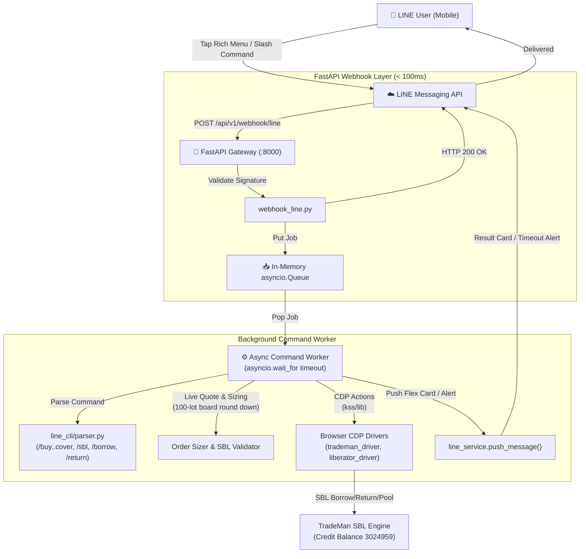

# Implementation Plan: Loop 2 — Async Queue, Value-Based Trading, Rich Menu UI & SBL Intelligence

แผนพัฒนา Loop 2 เพื่อยกระดับความเสถียร ประสบการณ์ผู้ใช้ ความสามารถในการส่งคำสั่ง และระบบบริหารจัดการหุ้นยืม **SBL (Securities Borrowing & Lending)** ของระบบ **InvestmentHomelab**

---

## 1. Goal Description

### วัตถุประสงค์หลักของ Loop 2
1. **Async Command Queue พร้อม Timeout**: ปรับปรุงการประมวลผลคำสั่งของ LINE Webhook จากการรันแบบ Synchronous ที่บล็อก HTTP Connection มาเป็นระบบ Queue ภายใน Gateway (In-Memory `asyncio.Queue` + Background Worker) ตอบรับ HTTP 200 ทันที และมี Timeout แยกตามประเภทคำสั่ง (30s คำสั่งทั่วไป / 180s ล็อกอิน OTP) แล้ว Push ผลลัพธ์กลับสู่ LINE แชต
2. **Value-Based & Live-Market Order Entry**: ขยายความสามารถของคำสั่ง `/buy`, `/sell`, `/short`, `/cover` ให้รองรับทั้ง:
   - **จำนวนหุ้น** (เช่น `/buy PTT 1000 34.50`)
   - **จำนวนเงินลงทุน THB** (เช่น `/buy PTT 50k` หรือ `/buy PTT 50000b`) โดยหากไม่ระบุราคา ระบบจะดึงราคาตลาดสด (Best Offer ฝั่งซื้อ/Best Bid ฝั่งขาย) มาคำนวณจำนวนหุ้นขั้นต่ำ Board Lot (ปัดเศษลงทวีคูณ 100 หุ้น) เพื่อไม่ให้เกินงบประมาณที่ระบุ
3. **SBL Intelligence & CLI Integration (Krungsri MARGIN 3024959)**:
   - คำสั่ง `/sbl` หรือ `/sbl status` (`/sbl sync`): ตรวจสอบรายการหุ้นยืม SBL คงค้าง, ดอกเบี้ยสะสม, วันที่ยืม, และแจ้งเตือนความเสี่ยง XD Corporate Actions
   - คำสั่ง `/sbl pool <symbol>`: ตรวจสอบจำนวนหุ้นยืมที่พร้อมให้ยืมในคลัง Krungsri TradeMan แบบ Real-time
   - คำสั่ง `/borrow <symbol> <vol>`: ยื่นขอยืมหุ้น SBL ผ่าน LINE โดยออก **SBL Borrow Confirmation Card** พร้อมสรุปดอกเบี้ย ~3.5% ต่อปี และคำนวณงบประมาณ
   - คำสั่ง `/return <symbol> [vol|all]`: ยื่นขอคืนหุ้น SBL เพื่อปลดภาระดอกเบี้ย
   - **เชื่อมโยง `/short` กับ SBL**: หากส่งคำสั่ง `/short` แล้วไม่มีหุ้นยืม SBL ในพอร์ต ระบบจะไม่ปฏิเสธอย่างไร้ทางออก แต่จะส่งข้อความแจ้งเตือนพร้อมปุ่ม Quick Reply ให้กด `/sbl pool <symbol>` และ `/borrow <symbol> <vol>` ได้ทันที
   - มี **DRY_RUN_MODE** และ Flex Card Confirmation ควบคุมความปลอดภัย
4. **Modern LINE UI & 4-Grid Rich Menu**: ออกแบบและติดตั้ง LINE Rich Menu ขนาด 4 ช่องใหญ่ (2x2 Grid) ใช้งานง่ายบนมือถือ:
   - [📊 พอร์ต & เงินสด] (`/port all sync`)
   - [📋 คำสั่ง & ต่อราคา] (`/orders all sync`)
   - [🔐 สถานะระบบ] (`/status`)
   - [⚡ ซื้อ/ขาย Quick Trade] (เปิด Interactive Trade Selection Card)
   - สคริปต์สร้างภาพ Rich Menu ขนาดมาตรฐาน 2500x1686 พิกเซล ด้วย Playwright Headless HTML Rendering (ได้ดีไซน์พรีเมียม Dark Mode สวยงาม ไม่ต้องลง Dependency เพิ่ม) และอัปโหลดเข้า LINE Messaging API อัตโนมัติ
5. **แก้ไขบั๊ก Reply Token ซ้ำใน Postback Handler**: แก้ไขจุดที่ `handle_postback` พยายามใช้ `reply_token` ซ้ำ 2 ครั้งเมื่อยืนยันออเดอร์ ทำให้ข้อความแจ้งผลยิงออเดอร์ไม่ส่งถึงผู้ใช้

---

## 2. Loop 1 vs Loop 2 Architecture Comparison

### ภาพสถาปัตยกรรม Loop 2 แบบองค์รวม (รวม SBL & Queue)


---

## 3. User Review Required (Aligned Decisions via /grill-me)

> [!IMPORTANT]
> **มติการออกแบบและความปลอดภัย (Confirmed via /grill-me):**
> 1. **Async Command Queue Lifecycle**: ตอบรับ HTTP 200 ให้ LINE Webhook ทันที เพื่อป้องกัน Timeout และปัญหา reply_token หมดอายุ โดยให้ Background Worker ส่งผลลัพธ์ผ่าน Push Message ไปยังห้องแชต
> 2. **Webhook & OTP Routing**: ตรวจจับและประมวลผล OTP Relay (2FA) แบบ Synchronous ทันทีเพื่อความรวดเร็วสูงสุดในการปลดล็อกล็อกอิน ส่วนคำสั่ง CLI และ Postback จะส่งเข้า `async_command_queue` ด้วย Database Session แยกต่างหาก
> 3. **XD Risk Hard-Block**: บล็อกคำสั่งยืม (`/borrow`) และคำสั่งชอร์ต (`/short`) เด็ดขาด หากหุ้นติดปฏิทิน XD/XR ใน SBL Real Time เพื่อป้องกันความเสี่ยงหนี้เงินปันผลชดเชย 100% (เรียกใช้ `krungsri_sbl_driver.check_symbol_risk()`)
> 4. **DRY_RUN_MODE Control**: ใช้ `DRY_RUN_MODE` ใน `.env` ส่วนกลางร่วมกันทั้งระบบเทรดและ SBL (เมื่อเป็น True ระบบจะจำลอง Lot ใน SQLite DB โดยไม่ยิงคำขอยืมไปยังโบรกเกอร์จริง)
> 5. **Rich Menu Deployment**: รันติดตั้งผ่าน CLI script `.venv/bin/python scripts/setup_rich_menu.py` เมื่อต้องการอัปเดต ไม่เพิ่มภาระตอน Gateway boot

> [!TIP]
> **Flow เชื่อมโยง `/short` สู่ `/borrow`:**
> เมื่อผู้ใช้สั่ง `/short PTT 50k` แล้วตรวจพบว่ายังไม่มีหุ้นยืม SBL ระบบจะตอบ:
> `❌ ไม่พบหุ้นยืม SBL ของ PTT (ต้องการ 1,400 หุ้น) — กรุณายืมหุ้นก่อนส่งคำสั่งชอร์ต`
> พร้อมแนบ Quick Reply: `[/sbl pool PTT]` และ `[/borrow PTT 1400]` ให้กดส่งคำขอยืมได้ในคลิกเดียว

---

## 4. Proposed Changes

### Component 1: SBL Command & Parser Suite (`app/services/line_cli/`)

#### [MODIFY] `app/services/line_cli/parser.py`
- เพิ่มคำสั่ง SBL เข้า `COMMAND_ALIASES`:
  - `sbl`: `sbl`, `หุ้นยืม`: `sbl`
  - `borrow`: `borrow`, `ยืมหุ้น`: `borrow`, `ยืม`: `borrow`
  - `return`: `return`, `คืนหุ้น`: `return`, `คืน`: `return`
- เพิ่ม Dataclass:
  - `SblCommand(cmd="sbl", subcmd="status|pool", symbol=Optional[str], flags={"sync"})`
  - `SblBorrowOrder(cmd="borrow", symbol=str, volume=int)`
  - `SblReturnOrder(cmd="return", symbol=str, volume=Optional[int])`

#### [MODIFY] `app/services/line_cli/handlers.py`
- เพิ่มฟังก์ชันจัดการ SBL:
  - `_handle_sbl_status(parsed, service, reply_token, push_target, db)`: แสดงรายการหุ้นยืมคงค้าง ดอกเบี้ย และวันถือครอง
  - `_handle_sbl_pool(parsed, service, reply_token, push_target)`: ดึงข้อมูลคลัง SBL จาก Krungsri SBL Real Time (`krungsri_sbl_driver.scrape_sbl_available_inventory(symbol)`)
  - `_handle_sbl_borrow(order, service, reply_token, push_target, db)`: ตรวจสอบ XD/XR hard block, คำนวณดอกเบี้ย, ออกบัตรยืนยันการยืม `sbl_borrow_confirm_card`
  - `_handle_sbl_return(order, service, reply_token, push_target, db)`: ตรวจสอบ lot ที่ยืมไว้, ออกบัตรยืนยันการคืน `sbl_return_confirm_card`
- ใน `handle_postback`:
  - รองรับ `action=sbl_borrow_confirm` และ `action=sbl_return_confirm`
  - เรียกใช้ `krungsri_sbl_driver.execute_sbl_borrow` และ `krungsri_sbl_driver.return_sbl_shares`
  - บันทึก/อัปเดตตาราง `sbl_borrow_lots` ใน SQLite
- ใน `_pre_trade_check` สำหรับฝั่ง `short`:
  - หากไม่มีหุ้นยืม SBL คืนค่า error พร้อม hint และ quick reply แนะนำ `/borrow`

#### [MODIFY] `app/services/line_cli/cards.py`
- เพิ่มการ์ด Flex Message:
  - `sbl_status_card(lots: List[SBLBorrowLot])`: แสดงรายการหุ้นยืมคงเหลือ
  - `sbl_pool_card(symbol: str, available_qty: int, fee_rate: float)`: แสดงสต็อก SBL
  - `sbl_borrow_confirm_card(symbol: str, volume: int, fee_rate: float, xd_warning: Optional[str])`: การ์ดยืนยันยืมหุ้น
  - `sbl_return_confirm_card(symbol: str, volume: int, days_held: int, accrued_fee: float)`: การ์ดยืนยันคืนหุ้น

---

### Component 2: Async Command Queue & Order Sizer (Loop 2 Core)

- `app/services/line_cli/queue.py`: In-memory `asyncio.Queue` + Background Worker + Timeout Guard
- `app/services/line_cli/parser.py`: Value-based order parsing (`50k`, `50000b`, `1000฿`, price optional)
- `app/services/line_cli/handlers.py`:
  - คำนวณ Board Lot ปัดเศษลง 100 หุ้นจากราคาตลาดสด
  - แก้บั๊ก postback double reply token

---

### Component 3: 4-Grid Rich Menu & Interactive UI

- `app/services/line_cli/rich_menu.py`: โครงสร้าง Rich Menu 4 ช่อง (2x2 Grid)
- `scripts/setup_rich_menu.py`: สคริปต์สร้างรูปภาพ 2500x1686 พิกเซล ด้วย Playwright Headless และติดตั้งลง LINE OA
- Quick Trade Flow: ปุ่มเลือก 4 ฝั่ง [🟢 BUY | 🔴 SELL | 🟣 SHORT | 🔵 COVER]

---

## 5. Verification Plan

### Automated Tests
1. **SBL Commands & Handlers Tests**:
   ```bash
   .venv/bin/python -m pytest tests/test_line_cli_sbl.py tests/test_line_cli_handlers_sbl.py -v
   ```
   - ทดสอบ parse: `/sbl`, `/sbl pool PTT`, `/borrow PTT 1000`, `/return PTT all`
   - ทดสอบ SBL draft creation, confirmation card, XD risk hard-block, and DB lot tracking
2. **Value Orders & Board Lot Calculator Tests**:
   ```bash
   .venv/bin/python -m pytest tests/test_line_cli_value_orders.py -v
   ```
3. **Async Queue Worker Tests**:
   ```bash
   .venv/bin/python -m pytest tests/test_line_async_queue.py -v
   ```
4. **Rich Menu Render & Spec Tests**:
   ```bash
   .venv/bin/python scripts/setup_rich_menu.py --render-only
   .venv/bin/python scripts/setup_rich_menu.py --dry-run
   ```
5. **Full Regression per Invariants**:
   ```bash
   .venv/bin/python scripts/verify_changes.py \
       app/services/line_cli/parser.py \
       app/services/line_cli/handlers.py \
       app/services/line_cli/cards.py \
       app/services/line_cli/queue.py
   ```

### Manual Verification
1. **SBL Query Test**:
   - พิมพ์ `/sbl` ใน LINE → ได้รับการ์ดสรุปรายการหุ้นยืม SBL
   - พิมพ์ `/sbl pool PTT` → ได้รับการ์ดจำนวนหุ้นที่ให้ยืมในพูล
2. **SBL Borrow & Short Flow (DRY_RUN)**:
   - พิมพ์ `/borrow PTT 1000` → ได้รับการ์ดยืนยันการยืม
   - กดยืนยัน → บันทึก Lot จำลองสำเร็จ
   - พิมพ์ `/short PTT 1000 34.50` → ตรวจพบ SBL lot และออกการ์ดยืนยันคำสั่ง Short
3. **Rich Menu & Quick Trade**:
   - กดปุ่ม [⚡ ซื้อ/ขาย Quick Trade] บน Rich Menu → ได้รับการ์ด 4 ฝั่ง
