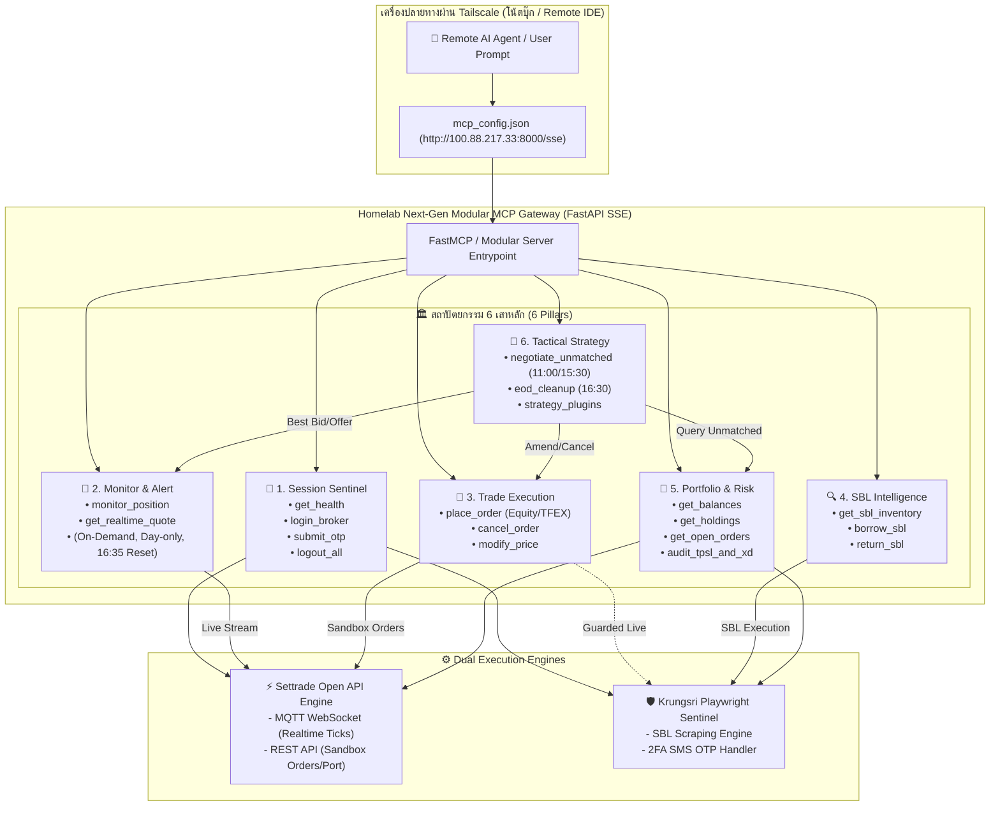

# 6-Pillars Modular MCP Architecture & Settrade Open API Hybrid Gateway
**เอกสารสถาปัตยกรรมระบบ: สถาปัตยกรรมโมดูลาร์ 6 เสาหลัก ผสาน Settrade Open API และ Krungsri Playwright Sentinel สำหรับ Remote AI Agent**

---

## 1. บทนำและผลการวิเคราะห์เปรียบเทียบ (Executive Summary)

จากการศึกษาและทดสอบเชิงลึกระหว่าง 3 เทคโนโลยี:
1. **Settrade Open API (v2 SDK)**: ระบบ Direct Machine-to-Machine API (REST + MQTT WebSocket)
2. **Click2Win เดิม (Playwright Browser)**: ระบบควบคุมเบราว์เซอร์อัตโนมัติบน `click2win.settrade.com`
3. **Krungsri Securities (TradeMan Playwright)**: ระบบควบคุมเบราว์เซอร์บน `trademan.in.th` ผ่าน SSO `efin.finance` และ 2FA SMS OTP

### ตารางวิเคราะห์เปรียบเทียบ (Comparison Matrix)

| มิติการเปรียบเทียบ | Settrade Open API (v2) | Click2Win เดิม (Playwright) | Krungsri เดิม (TradeMan) |
| :--- | :--- | :--- | :--- |
| **โปรโตคอลหลัก** | HTTPS REST + MQTT over WebSocket | Headed/Headless Chromium (DOM) | Headed/Headless Chromium (DOM) |
| **ความเร็วคำสั่ง (Latency)** | 🟢 ต่ำมาก (10 - 50 ms) | 🔴 ช้า (1.5 - 3.0 วินาที) | 🔴 ช้า (2.0 - 4.5 วินาที) |
| **การยืนยันตัวตน (Auth)** | App ID, Secret, HMAC Token อัตโนมัติ | Username + Password (ไม่มี OTP) | Username + Password + 2FA SMS OTP |
| **ความเสถียรของหน้าจอ** | 🟢 100% ไม่ขึ้นกับ DOM หรือ UI | 🟡 เปราะบางต่อการเปลี่ยน DOM/Popup | 🟡 เปราะบางต่อการเปลี่ยน DOM/Popup |
| **Real-time Market Data** | 🟢 สตรีมระดับ Ticks, Bid/Offer 5 แถว | 🔴 ต้อง Polling กวาด DOM หน้าเว็บ | 🔴 ต้อง Polling กวาด DOM หน้าเว็บ |
| **การรองรับ SBL (ยืม/คืนหุ้น)**| 🔴 ไม่มีเมนู SBL ใน API มาตรฐาน | 🔴 ไม่มีระบบ SBL Sandbox | 🟢 **มีระบบ SBL เต็มรูปแบบบน efin** |
| **ภาระทรัพยากร (CPU/RAM)** | 🟢 ต่ำมาก (~30 MB RAM) | 🔴 สูง (Chromium ~400-800 MB) | 🔴 สูง (Chromium ~500-900 MB) |

### สรุปยุทธศาสตร์ Hybrid:
- **Settrade Open API**: รับผิดชอบ **Real-time Market Data**, **Order Execution บน Sandbox**, และ **Intraday Price Watch**
- **Krungsri Playwright**: รับผิดชอบ **SBL Intelligence (ยืม/คืนหุ้น)** และ **การเชื่อมต่อพอร์ตจริงของ KSS**

---

## 2. แผนภาพสถาปัตยกรรมระบบรวม (End-to-End Architecture)



---

## 3. รายละเอียดและสเปกของ 6 เสาหลัก (The 6 Pillars Specification)

### 🏛️ Pillar 1: Session Sentinel (`pillar1_session.py`)
- **วัตถุประสงค์**: ดูแลสุขภาพการเชื่อมต่อและการยืนยันตัวตนแบบรวมศูนย์
- **Tools**:
  - `session_get_health()`: คืนค่าสถานะความพร้อมของทั้งสองระบบ (Settrade Token Status, Krungsri Browser Session, Last Heartbeat)
  - `session_login_broker(platform)`: สั่งล็อกอิน Krungsri หรือต่ออายุ Settrade Token
  - `session_submit_otp(otp_code)`: ป้อนรหัส SMS OTP 6 หลักในกรณีฉุกเฉิน (หาก KDE Connect ไม่ตรวจจับ)
  - `session_logout_all()`: ปิดเบราว์เซอร์และเคลียร์ Token อย่างปลอดภัย

### 🏛️ Pillar 2: Account & Portfolio (`pillar2_portfolio.py`)
- **วัตถุประสงค์**: ศูนย์กลางข้อมูลบัญชีและพอร์ตโฟลิโอของทุกโบรกเกอร์ (Unified Snapshot)
- **กฎเหล็ก (Strict Business Rules)**:
  1. **Account Capability Matrix**: สลับ/ตรวจสอบสิทธิ์บัญชีตามประเภทสินทรัพย์ (EQUITY / DERIVATIVES / CASH / MARGIN)
  2. **Single-Account Clamp**: Liberator มีบัญชี CASH เดียว — คำขอ MARGIN/DERIVATIVES จะถูก clamp พร้อมแจ้งเตือนตามจริง
  3. **SBL Exclusivity**: SBL สงวนสิทธิ์เฉพาะ Krungsri MARGIN เท่านั้น
- **Tools**:
  - `portfolio_list_accounts(platform)`
  - `switch_account(platform, account_type)`
  - `portfolio_get_balances(platform, account_type)`
  - `portfolio_holdings(platform, account_type)`
  - `current_open_orders(platform, account_type)`
  - `portfolio_sync_db()`
- **NOTE (2026-10-06)**: ฟีเจอร์ "Monitor & Alert" (monitor engine, alert rules, watchlist, `app/monitoring/`) ถูก **ลบออกทั้งหมด** แล้ว

### 🏛️ Pillar 3: Trade Execution (`pillar3_trade.py`)
- **วัตถุประสงค์**: ส่งคำสั่งซื้อขาย ยกเลิก และปรับปรุงออเดอร์
- **Tools**:
  - `trade_place_order(symbol, side, volume, price, price_type, platform)`: ส่งคำสั่งเข้า Settrade Sandbox (ไว <50ms) หรือจำลอง KSS
  - `trade_cancel_order(order_no, platform)`: ยกเลิกคำสั่งทันที
  - `trade_modify_price(order_no, new_price, platform)`: ปรับปรุงราคาคำสั่ง

### 🏛️ Pillar 4: SBL Intelligence (`pillar4_sbl.py`)
- **วัตถุประสงค์**: บริหารจัดการการยืมและคืนหุ้นสำหรับกลยุทธ์ Short Selling ผ่าน Krungsri TradeMan
- **Tools**:
  - `sbl_get_inventory(symbols)`: ตรวจสอบจำนวนหุ้นที่มีให้ยืม (Available Inventory)
  - `sbl_borrow_stock(symbol, volume, dry_run)`: ส่งคำสั่งขอยืมหุ้น
  - `sbl_return_stock(symbol, volume, dry_run)`: ส่งคำสั่งคืนหุ้น
  - `sbl_check_corporate_actions(symbol)`: ตรวจสอบเครื่องหมาย XD/XM เพื่อป้องกันความเสี่ยงดอกเบี้ยและเงินปันผลชดเชย

### 🏛️ Pillar 6: Tactical Strategy Center (`pillar6_strategy.py`)
- **วัตถุประสงค์**: ดำเนินกลยุทธ์ขั้นสูงบนคำสั่งและพอร์ต
- **Tools**:
  - `strategy_negotiate_unmatched_orders(round_name)`: กลยุทธ์ต่อราคาสำหรับคำสั่งค้างท่อ (รัน 11:00 น. และ 15:30 น.) สแกนคำสั่งที่ยังไม่ Match ดึง Bid1/Offer1 แล้ววางราคาล่อตลาดใหม่
  - `strategy_eod_order_cleanup()`: ยกเลิกคำสั่งที่ค้างอยู่ ณ เวลา 16:35 น. ป้องกันออเดอร์ค้างข้ามคืน
  - `strategy_list_active()`: ตรวจสอบสถานะการทำงานของกลยุทธ์ทั้งหมด

### 🌐 System Discovery Tool: Architecture Overview (`overview.py`)
- **วัตถุประสงค์**: ศูนย์เปิดเผยพิมพ์เขียวสถาปัตยกรรม 6 เสาหลักแก่ Remote AI Agent เมื่อเริ่มต้น Session
- **Tool**:
  - `mcp_get_6pillars_overview()`: คืนค่า JSON พิมพ์เขียวระบุรายชื่อโบรกเกอร์ทั้งหมดที่ลงทะเบียนใน `broker_registry`, โปรโตคอลการเชื่อมต่อ, เครื่องมือประจำแต่ละเสาหลัก, และ Guardrails ทั้งหมด เพื่อให้ AI Agent วางแผนการทำงานได้อัตโนมัติ

---

## 4. โครงสร้างระบบแยกส่วนและระบบโบรกเกอร์แบบเสียบปลั๊ก (Pluggable Broker Architecture)

เพื่อแก้ปัญหาความเชื่อมโยงแน่นหนา (Monolithic Coupling) ที่เสี่ยงต่อ Regression เวลาเพิ่มโบรกเกอร์ใหม่ ระบบจึงแยกสถาปัตยกรรมออกเป็น **Isolated Broker Plugins** ภายใต้ `app/brokers/`:

```
app/brokers/
├── base.py                          # BaseBrokerPlugin Interface & Unified Data Models
├── registry.py                      # BrokerRegistry (Dynamic discovery & health routing)
├── krungsri/                        # Krungsri TradeMan Pro Plugin (Playwright SSO, SBL)
├── click2win/                       # Settrade Click2Win Plugin (Playwright Sandbox)
│   └── cli.py                       # Standalone CLI Tester for Click2Win
├── settrade_openapi/                # Settrade Open API Plugin (Direct REST/MQTT M2M)
└── liberator/                       # Liberator Securities Plugin (Playwright WebTrade)
    └── cli.py                       # Standalone CLI Tester for Liberator
```

### โครงสร้างไฟล์ MCP 6 เสาหลัก (Directory Layout)

```
app/mcp/
├── __init__.py
├── remote_server.py                 # Backward-compatible bridge for legacy tests
├── server.py                        # Modular MCP Server Gateway (SSE at /sse, /messages/)
└── pillars/
    ├── __init__.py                  # 6-Pillars exports & registration
    ├── overview.py                  # Architecture discovery tool (mcp_get_6pillars_overview)
    ├── pillar1_session.py           # Pillar 1: Session Sentinel & KDE Connect Bridge
    ├── pillar2_portfolio.py         # Pillar 2: Account & Portfolio (Unified Snapshot)
    ├── pillar3_trade.py             # Pillar 3: Trade Execution & Risk Guardrails
    ├── pillar4_sbl.py               # Pillar 4: SBL Intelligence (Krungsri exclusive)
    └── pillar6_strategy.py          # Tactical Strategy Center (Negotiation & EOD Cleanup)
```

---

## 5. การเชื่อมต่อ Remote MCP ผ่าน Tailscale (AI Agent Setup)

### ตั้งค่าใน `mcp_config.json` หรือ Claude Desktop / Antigravity / Cursor

```json
{
  "mcpServers": {
    "investment-homelab": {
      "url": "http://100.88.217.33:8000/sse"
    }
  }
}
```

เมื่อเชื่อมต่อแล้ว AI Agent สามารถสั่ง:
1. `mcp_get_6pillars_overview()` เพื่อดึงสถานะและความพร้อมของทั้ง 6 เสาหลัก
2. `session_get_health()` เพื่อตรวจเช็กสถานะการยืนยันตัวตนของโบรกเกอร์
3. `portfolio_list_accounts()` เพื่อเลือกบัญชีและดูพอร์ตการลงทุน
4. ดำเนินการส่งคำสั่งหรือเฝ้าระวังราคาได้อย่างปลอดภัยตาม Guardrails ที่วางไว้
