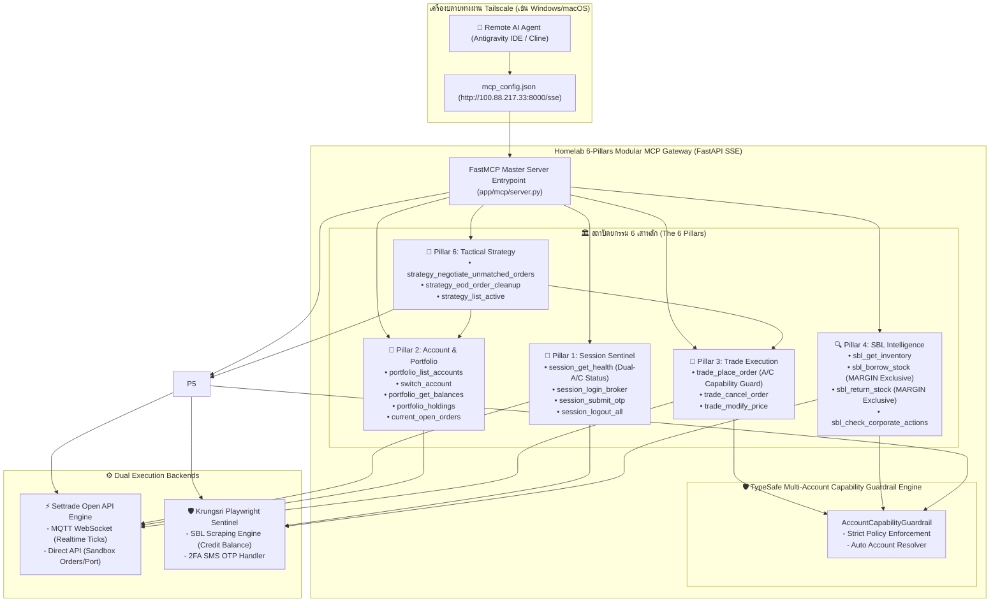

# คู่มือการติดตั้งและใช้งาน Remote MCP Server (สถาปัตยกรรม 6 Pillars Modular Gateway)
**สำหรับเชื่อมต่อควบคุมการเทรด, ตรวจสอบพอร์ต, มอนิเตอร์ราคา Real-time, และจัดการ SBL ข้ามเครื่องผ่านเครือข่าย Tailscale พร้อมระบบแยกบัญชี TypeSafe Multi-Account Guardrails**

---

## 1. ภาพรวมสถาปัตยกรรม (Architecture Overview)

ระบบถูกออกแบบตามสถาปัตยกรรม **6 Pillars Modular Architecture** ผสาน **Settrade Open API (v2 SDK)** สำหรับงานความเร็วสูง (Low-latency orders, Real-time MQTT ticks) และ **Krungsri Playwright Sentinel** สำหรับงานตรวจสอบพอร์ตและ SBL บน `trademan.in.th`:



- **IP เครื่อง Home-lab (Tailscale)**: `100.88.217.33` (พอร์ต `8000`)
- **MCP Endpoint**: `http://100.88.217.33:8000/sse`

---

## 2. โครงสร้างบัญชีและข้อกำหนดด้านความปลอดภัย (Multi-Account & Capability Matrix)

ระบบแบ่งแยกบัญชีออกเป็น **2 บัญชีต่อโบรกเกอร์** โดยมีกฎ **Strict Capability Guardrail** ควบคุมอย่างเข้มงวด:

| โบรกเกอร์ / แพลตฟอร์ม | บัญชีที่ 1 | บัญชีที่ 2 | สิทธิ์และขอบเขตการทำงาน (Strict Capabilities) |
| :--- | :--- | :--- | :--- |
| **Settrade Click2Win** | `EQUITY` (หุ้น) | `DERIVATIVES` (TFEX) | • `EQUITY`: ซื้อขายหุ้น SET, ดูพอร์ต, ต่อราคา (ห้ามส่ง TFEX)<br/>• `DERIVATIVES`: เทรด TFEX Futures/Options (ห้ามส่งหุ้น) |
| **Krungsri Securities** | `CASH` (Cash Balance) | `MARGIN` (Credit Balance) | • `CASH`: ซื้อขายหุ้นสด, ดูพอร์ต (ห้ามทำ SBL)<br/>• `MARGIN`: ซื้อขายหุ้น, ดูพอร์ต, **ยืม/คืนหุ้น SBL (เฉพาะบัญชีนี้เท่านั้น!)** |
| **Settrade Open API** | `EQUITY` (Sandbox) | `DERIVATIVES` (Sandbox) | • `EQUITY`: ส่งคำสั่งหุ้นความเร็วสูง (<50ms)<br/>• `DERIVATIVES`: ส่งคำสั่งอนุพันธ์ TFEX |

> [!IMPORTANT]
> **SBL Guardrail Rule**: การยืม (`sbl_borrow_stock`) และการคืน (`sbl_return_stock`) หุ้น SBL สงวนสิทธิ์เฉพาะบัญชี **Krungsri `MARGIN`** เท่านั้น หากเรียกบน Click2Win หรือเรียกบนบัญชี `CASH` ระบบจะปฏิเสธคำสั่งทันทีพร้อมระบุวิธีแก้ไข

---

## 3. ขั้นตอนการตั้งค่าบนเครื่องปลายทาง (Remote Machine)

### สำหรับ Antigravity IDE
1. บนเครื่องปลายทาง เปิดหรือสร้างไฟล์ตั้งค่า:
   - **Windows**: `%USERPROFILE%\.gemini\config\mcp_config.json`  
     (ตัวอย่าง: `C:\Users\<ชื่อผู้ใช้>\.gemini\config\mcp_config.json`)
   - **macOS / Linux**: `~/.gemini/config/mcp_config.json`

2. ใส่การตั้งค่าดังนี้:
```json
{
  "mcpServers": {
    "homelab-trading": {
      "serverUrl": "http://100.88.217.33:8000/sse"
    }
  }
}
```

3. รีสตาร์ท Antigravity IDE หรือเปิดห้องแชทใหม่ AI Agent จะค้นพบ Tools ทั้ง 6 Pillars อัตโนมัติ

---

## 4. รายชื่อ Tools ครบทั้ง 6 Pillars (Complete 6-Pillars Toolset)

### 🔐 Pillar 1: Session Sentinel
| Tool Name | คำอธิบาย | พารามิเตอร์สำคัญ |
| :--- | :--- | :--- |
| `session_get_health` | ตรวจสอบสถานะการเชื่อมต่อแบบรวมศูนย์ พร้อมแสดงสถานะบัญชี Active (ทั้ง Click2Win, Krungsri, Settrade) | - |
| `session_login_broker` | สั่ง Initial Login หรือต่ออายุเซสชัน (ดึง Username/Password จาก `.env` บน Homelab) | `platform` ("CLICK2WIN" / "KRUNGSRI") |
| `session_submit_otp` | ส่งรหัส 2FA SMS OTP (6 หลัก) สำหรับยืนยันการล็อกอิน Krungsri | `otp_code` (เช่น "123456") |
| `session_logout_all` | ปิดเบราว์เซอร์และเคลียร์เซสชันทั้งหมดอย่างปลอดภัย | - |

### 🚀 Pillar 3: Trade Execution
| Tool Name | คำอธิบาย | พารามิเตอร์สำคัญ |
| :--- | :--- | :--- |
| `trade_place_order` | ส่งคำสั่งซื้อขายเข้า Click2Win หรือ Krungsri พร้อมตรวจสอบ Board Lot, Max Value, และ **Account Capability Guardrails** (หุ้นต้องเข้า EQUITY/CASH, TFEX ต้องเข้า DERIVATIVES) | `symbol`, `side` ("BUY"/"SELL"/"LONG"/"SHORT"), `volume`, `price`, `platform`, `account_type` (Optional) |
| `trade_cancel_order` | ยกเลิกคำสั่งซื้อขายที่รออยู่ในกระดานตามเลขที่ออเดอร์ | `order_no`, `platform`, `symbol` |
| `trade_modify_price` | แก้ไขราคาออเดอร์ที่รอคิวอยู่บนกระดาน | `order_no`, `new_price`, `platform`, `symbol` |

### 🔍 Pillar 4: SBL Intelligence (ยืม/คืนหุ้น)
| Tool Name | คำอธิบาย | พารามิเตอร์สำคัญ |
| :--- | :--- | :--- |
| `sbl_get_inventory` | ตรวจสอบพูลหุ้นที่เปิดให้ยืม (Available Inventory) และอัตราดอกเบี้ยบน Krungsri TradeMan | `symbols` (เช่น `["CPALL", "PTT"]`) |
| `sbl_borrow_stock` | ส่งคำสั่งขอยืมหุ้น SBL (รองรับ Dry-run mode) **จำกัดสิทธิ์เฉพาะ Krungsri MARGIN เท่านั้น** | `symbol`, `volume`, `dry_run`, `platform` ("KRUNGSRI"), `account_type` ("MARGIN") |
| `sbl_return_stock` | ส่งคำสั่งคืนหุ้น SBL เพื่อปิดภาระหนี้ **จำกัดสิทธิ์เฉพาะ Krungsri MARGIN เท่านั้น** | `symbol`, `volume`, `dry_run`, `platform` ("KRUNGSRI"), `account_type` ("MARGIN") |
| `sbl_check_corporate_actions` | ตรวจสอบสิทธิประโยชน์ XD/XM/XR เพื่อป้องกันความเสี่ยงดอกเบี้ยและปันผลชดเชย | `symbol` |

### 💼 Pillar 2: Account & Portfolio
| Tool Name | คำอธิบาย | พารามิเตอร์สำคัญ |
| :--- | :--- | :--- |
| `portfolio_list_accounts` | **สารบัญบัญชีเทรดทั้งหมด**: แสดงเลขบัญชี, ชื่อโบรกเกอร์, ประเภท (Equity/TFEX/Cash/Margin), ระบบเงิน (เงินจริง vs เงินเสมือน), สิทธิ์ที่ทำได้, และสถานะ Active พร้อมตารางสรุป Markdown | `platform` (Optional: "CLICK2WIN" / "KRUNGSRI" / "SETTRADE_OPENAPI") |
| `switch_account` | **เครื่องมือสลับบัญชีทำงานหลัก**: เปลี่ยน Active Account และปรับสิทธิ์ Capability ทันที | `platform` ("CLICK2WIN" / "KRUNGSRI" / "SETTRADE_OPENAPI"), `account_type` ("EQUITY" / "DERIVATIVES" / "CASH" / "MARGIN") |
| `portfolio_get_balances` | ดูยอดเงินสด (Cash), วงเงินซื้อขาย (Line), Total Equity แยก 2 บัญชีต่อแพลตฟอร์มพร้อมระบุ Active Account | `platform`, `account_type` (Optional) |
| `portfolio_holdings` | ดูรายการหุ้นที่ถือครอง, ปริมาณพร้อมขาย, ต้นทุนเฉลี่ย, และ Unrealized P/L แยกตามบัญชี | `platform`, `account_type` (Optional) |
| `current_open_orders` | ดูคำสั่งซื้อขายที่รอจับคู่ (`Queuing(SX)`, `Partially Matched`) แยกตามบัญชี | `platform`, `account_type` (Optional) |
| `portfolio_sync_db` | สั่งบันทึก Snapshot พอร์ตโฟลิโอปัจจุบันลงฐานข้อมูล SQLite `positions` | - |

### 🎯 Pillar 6: Tactical Strategy Center
| Tool Name | คำอธิบาย | พารามิเตอร์สำคัญ |
| :--- | :--- | :--- |
| `strategy_negotiate_unmatched_orders` | กลยุทธ์ต่อราคาออเดอร์ค้างท่อ (รอบ 11:00 และ 15:30) ปรับราคาแบบ Passive Lure (Bid1/Offer1) ไม่ให้เกิด Slippage | `round_name` ("11:00" / "15:30"), `tactic` ("PASSIVE_LURE" / "AGGRESSIVE") |
| `strategy_eod_order_cleanup` | ยกเลิกออเดอร์ค้างทั้งหมด ณ เวลา 16:30 น. ก่อนตลาดปิด ป้องกันออเดอร์ค้างข้ามคืน | `platform` |
| `strategy_list_active` | ตรวจสอบรายการกลยุทธ์ที่มีให้ใช้งาน | - |

---

## 5. ตัวอย่างการสั่งงาน AI บนเครื่อง Remote

### ตัวอย่างที่ 1: ตรวจสอบเลขบัญชีและแยกระบบเงินจริง/เสมือน (Pillar 5)
> *"ตอนนี้เรามีบัญชีอะไรบ้าง แต่ละบัญชีเลขอะไร เป็นเงินจริงหรือเงินเสมือน และทำอะไรได้บ้าง"*  
*(AI เรียก `portfolio_list_accounts()`)*  
**ตัวอย่างการแสดงผล**:
```markdown
| โบรกเกอร์ / สถาบัน | เลขบัญชี | ประเภทบัญชี | ระบบเงิน | สิทธิ์ที่ทำได้ (Capabilities) | สถานะ Active | คำสั่งสลับบัญชี (Switch Command) |
| :--- | :--- | :--- | :--- | :--- | :---: | :--- |
| Settrade Click2Win | `CW32_E_7338419` | **EQUITY** | 🟡 เงินเสมือน (Click2Win Sandbox 5M) | EQUITY_TRADE, PORTFOLIO_READ, PRICE_NEGOTIATE | ✅ **ACTIVE** | `portfolio_switch_account(platform='CLICK2WIN', account_type='EQUITY')` |
| Settrade Click2Win | `CW32_D_7338419` | **DERIVATIVES** | 🟡 เงินเสมือน (Click2Win TFEX Sandbox 2M) | TFEX_TRADE, PORTFOLIO_READ, PRICE_NEGOTIATE | ⚪ Standby | `portfolio_switch_account(platform='CLICK2WIN', account_type='DERIVATIVES')` |
| Krungsri Securities (TradeMan) | `3024952` | **CASH** | 🟢 เงินจริง (Krungsri Cash Balance) | EQUITY_TRADE, PORTFOLIO_READ | ✅ **ACTIVE** | `portfolio_switch_account(platform='KRUNGSRI', account_type='CASH')` |
| Krungsri Securities (TradeMan) | `3024959` | **MARGIN** | 🟢 เงินจริง (Krungsri Credit Balance / Margin) | EQUITY_TRADE, PORTFOLIO_READ, SBL_BORROW, SBL_RETURN | ⚪ Standby | `portfolio_switch_account(platform='KRUNGSRI', account_type='MARGIN')` |
| Settrade Open API (Machine-to-Machine) | `SANDBOX-EQ-001` | **EQUITY** | 🟡 เงินเสมือน (Open API Sandbox) | EQUITY_TRADE, PORTFOLIO_READ | ✅ **ACTIVE** | `portfolio_switch_account(platform='SETTRADE_OPENAPI', account_type='EQUITY')` |
| Settrade Open API (Machine-to-Machine) | `SANDBOX-DERIV-002` | **DERIVATIVES** | 🟡 เงินเสมือน (Open API TFEX Sandbox) | TFEX_TRADE, PORTFOLIO_READ | ⚪ Standby | `portfolio_switch_account(platform='SETTRADE_OPENAPI', account_type='DERIVATIVES')` |
```

### ตัวอย่างที่ 2: สลับบัญชีทำงาน (Pillar 5)
> *"สลับบัญชี Krungsri ไปเป็น MARGIN เพื่อเตรียมทำ SBL"*  
*(AI เรียก `portfolio_switch_account(platform="KRUNGSRI", account_type="MARGIN")`)*  
> *"สลับบัญชี Click2Win ไปเป็น TFEX Derivatives"*  
*(AI เรียก `portfolio_switch_account(platform="CLICK2WIN", account_type="DERIVATIVES")`)*

### ตัวอย่างที่ 2: การทำงานของ Strict Guardrail (เมื่อเรียกผิดบัญชี)
> *"ขอยืมหุ้น CPALL 1,000 หุ้น ใน Click2Win"*  
*(AI เรียก `sbl_borrow_stock(symbol="CPALL", volume=1000, platform="CLICK2WIN")`)*  
**ผลลัพธ์จาก Guardrail**:
```json
{
  "success": false,
  "error_type": "ACCOUNT_CAPABILITY_GUARDRAIL_REJECTION",
  "reason": "Strict Guardrail Rejection: SBL operation 'SBL_BORROW' is strictly restricted to Krungsri 'MARGIN' (Credit Balance) accounts. Current target is CLICK2WIN 'EQUITY'. Please switch account using portfolio_switch_account(platform='KRUNGSRI', account_type='MARGIN') first."
}
```

### ตัวอย่างที่ 3: ดูยอดเงินและพอร์ตแยกบัญชี (Pillar 5)
> *"ขอดูยอดเงินคงเหลือและวงเงินซื้อขายของ Krungsri ทั้งบัญชี Cash และ Margin หน่อย"*  
*(AI เรียก `portfolio_get_balances(platform="KRUNGSRI")`)*

### ตัวอย่างที่ 4: ส่งคำสั่งซื้อขายและต่อราคา (Pillar 3 & 6)
> *"ส่งคำสั่งซื้อ PTT 500 หุ้น ที่ราคา 33.50 บน Click2Win บัญชีหุ้น"*  
*(AI เรียก `trade_place_order(symbol="PTT", side="BUY", volume=500, price=33.50, platform="CLICK2WIN", account_type="EQUITY")`)*  
> *"มีออเดอร์ที่ยังไม่ Match ไหม ถ้ามีให้ใช้กลยุทธ์ต่อราคาแบบ PASSIVE_LURE ปรับให้ตรงกับ Bid1 ทันที"*  
*(AI เรียก `strategy_negotiate_unmatched_orders(round_name="11:00", tactic="PASSIVE_LURE")`)*

---

## 6. การทดสอบการเชื่อมต่อ (Connectivity Verification)

```bash
# ทดสอบความพร้อมของ FastAPI Gateway:
curl http://100.88.217.33:8000/health
# ผลลัพธ์: {"status":"healthy"}

# ทดสอบสตรีม SSE ของ MCP Server:
curl -i -N -H "Accept: text/event-stream" http://100.88.217.33:8000/sse
# ผลลัพธ์: event: endpoint / data: /messages/?session_id=...
```
