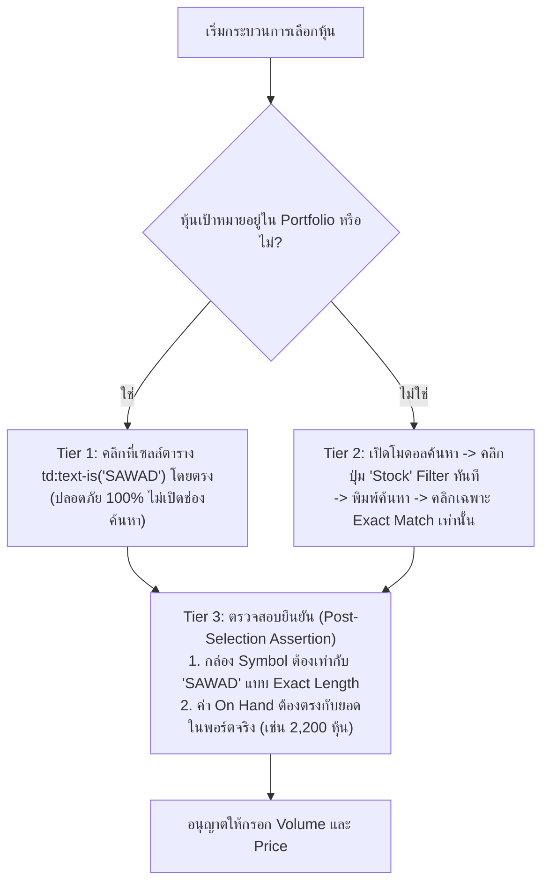

# TradeMan Order Execution Runbook & DOM Specification (Krungsri Securities)
**Platform:** `KRUNGSRI` (TradeMan Pro / Nuxt Single Page App)  
**Main URL:** `https://trademan.in.th/Portfolio`  
**Verified Date:** 2026-09-29  
**Related RCA:** `KSS-RCA-006` (Derivative Warrant Collision Risk)

---

## 1. Executive Summary & Verified DOM Architecture
การตรวจสอบโครงสร้าง DOM จริงบนหน้าจอ TradeMan พบว่าระบบส่งคำสั่งไม่ได้เป็นฟอร์ม HTML ทั่วไปที่มี ID คงที่เหมือนระบบดั้งเดิม แต่เป็น Nuxt/Vue Dynamic Component ที่มีลักษณะเฉพาะดังนี้:

| องค์ประกอบ (Element) | Verified DOM Selector | พฤติกรรมเฉพาะ (Behaviors & Nuances) |
| :--- | :--- | :--- |
| **แผง Buy/Sell Sidebar** | `div[title='Buy/Sell']` | อยู่บนแถบเมนูด้านขวา `#myMenu` ต้องคลิกเปิดหากแผงยังพับอยู่ |
| **เลขบัญชีที่สั่งการ** | `#dropDownAccount` | แสดงเลขบัญชีที่กำลังส่งคำสั่ง เช่น `3024959` (Margin) |
| **ปุ่มเลือกฝั่ง (Side)** | `span:text-is('{BUY\|SELL\|SHORT\|COVER}')` | อยู่ในคอนเทนเนอร์ `.flex-row.gap-2` ปรับสีตามฝั่ง (BUY เขียว, SELL แดง) |
| **กล่องเลือกหุ้น (Symbol)** | `div:has-text('Symbol') + div` | คอนเทนเนอร์สีเทาเข้ม `.bg-[#2B313A]` เมื่อคลิกจะเปิดโมดอล Symbol Search |
| **ช่อง Volume** | `input[id$='-order-volume']` | Dynamic ID: `#Buy-order-volume` หรือ `#Sell-order-volume` ตามฝั่งที่เลือก |
| **ช่อง Price** | `input[id$='-order-price']` | Dynamic ID: `#Buy-order-price` หรือ `#Sell-order-price` พร้อมปุ่ม `-` และ `+` |
| **ปุ่มส่งคำสั่ง (Send)** | `button#send_order__btn` | ปุ่มสีเขียวสำหรับ BUY / สีแดงสำหรับ SELL ไม่มีปุ่ม Submit แบบเดิม |
| **โมดอลยืนยัน (Order Confirm)** | `.v-overlay--active:has-text('Order Confirm')` | โมดอลเด้งขึ้นมากลางจอหลังกด Send แสดงรายละเอียดคำสั่งครบถ้วน |
| **ช่องกรอก PIN** | `input#pin` | ซ่อนรหัสด้วย CSS `style="font-family: password;"` ไม่ใช่ `type='password'` |
| **ช่องบันทึก PIN** | `input#savepin` | Checkbox `Save PIN` สำหรับจำรหัสไว้ในรอบเซสชัน |
| **ปุ่มยืนยันส่งจริงในโมดอล** | `button:has(span:text-is('Sell\|Buy'))` | ปุ่มสีแดงสำหรับ Sell / ปุ่มสีเขียวสำหรับ Buy มีข้อความอยู่ใน `span` |
| **แท็บรายการคำสั่ง (View Order)** | `div#order_btn` | แท็บดูรายการคำสั่งทั้งหมด (สถานะเป็นคำเต็ม: Open / Matched / Canceled / Reject) — ดู §5 |

---

## 2. ⚠️ Critical Safety Lesson: ความเสี่ยง DW ชนหุ้นแม่ (KSS-RCA-006)
ในการทดสอบรอบแรก เมื่อเปิดโมดอลค้นหาแล้วพิมพ์คำว่า `SAWAD` รายการผลลัพธ์ดึง `SAWAD01C2612A` (Derivative Warrant - DW) ขึ้นมาเป็นลำดับแรก หากใช้ `.first` หรือคำสั่งจับข้อความแบบไม่ระบุประเภทหุ้น ระบบจะเตรียมคำสั่งขาย DW ทันที ซึ่งเป็นความเสี่ยงระดับสูงสุด (Catastrophic Fat-Finger Risk)

### มาตรการป้องกัน 3 ชั้น (3-Tier Anti-DW Guardrails):


---

## 3. หลักฐานการส่งคำสั่งจริงและการจับคู่ในตลาด (Live Execution Evidence)

| หลักทรัพย์ | ฝั่ง | จำนวน (หุ้น) | ราคา (Offer 1) | มูลค่า (บาท) | เลขที่คำสั่ง (Order No.) | สถานะบนกระดาน | ภาพถ่ายหลักฐาน |
| :--- | :---: | :---: | :---: | :---: | :---: | :---: | :---: |
| **SAWAD** | `SELL` | 2,200 | **22.50** | 49,500 | `11011353` | 🟢 **`M` (MATCHED)** | `trademan_sawad_live_postmodal.png` |
| **COCOCO** | `SELL` | 8,800 | **5.65** | 49,720 | `11012119` | 🟢 **`M` (MATCHED)** | `trademan_cococo_submitted.png` |
| **AAV** | `SELL` | 57,000 | **0.84** | 47,880 | `11012916` | 🟡 **`O` (OPEN / QUEUE)** | `trademan_aav_submitted.png` |

> **ผลสัมฤทธิ์ของรอบเช้า (2026-09-29):**
> * ปลดล็อกเงินสดเข้า Purchasing Power (PP) ทันที: **`99,220` บาท** (จาก SAWAD และ COCOCO ที่ Matched ครบ 100%)
> * มูลค่าคำสั่งเสนอขายที่กำลังเข้าคิวรอ Matched: **`47,880` บาท** (AAV เสนอขายที่ Best Offer 1)
> * รวมมูลค่าการหมุนเวียนเงินสดปิดไม้: **`147,100` บาท** สำเร็จลุล่วงตามกติกา Tactical Windows โดยไม่มีความคลาดเคลื่อน!

---

## 4. รันบุ๊กคำสั่ง Playwright สำหรับ Automation

```python
# 1. ตรวจสอบหน้า Portfolio และปิดป๊อปอัป
if "portfolio" not in (page.url or "").lower():
    await page.goto("https://trademan.in.th/Portfolio")
await popup_manager.dismiss_popups(page)

# 2. เปิดแถบ Buy/Sell หากยังไม่แสดง
if not await page.evaluate("() => !!document.getElementById('send_order__btn')"):
    await page.click("div[title='Buy/Sell']")

# 3. เลือกฝั่ง (BUY / SELL / SHORT / COVER)
await page.locator(f"span:text-is('{side}')").first.click()

# 4. เลือกหุ้นแบบ Anti-DW
# ลำดับแรก: ลองคลิกจากตารางในพอร์ต
table_selected = await page.evaluate("""(targetSym) => {
    const tds = Array.from(document.querySelectorAll("td"));
    const match = tds.find(td => td.innerText && td.innerText.trim() === targetSym);
    if (match) { match.click(); return true; }
    return false;
}""", symbol)

if not table_selected:
    # ลำดับสอง: ค้นหาผ่านโมดอล โดยกดปุ่ม Stock ก่อนเสมอ
    await page.click("div:has-text('Symbol') + div")
    await page.locator(".v-overlay--active button:text-is('Stock')").first.click()
    await page.locator(".v-overlay--active input").first.fill(symbol)
    await page.evaluate("""(targetSym) => {
        const items = Array.from(document.querySelectorAll(".v-overlay--active *"));
        const match = items.find(el => el.innerText && el.innerText.trim() === targetSym && el.children.length === 0);
        if (match) match.click();
    }""", symbol)

# 5. Assert ความถูกต้อง
active_sym = await page.evaluate("""() => {
    const el = document.querySelector(".col-span-3.bg-\\\\[\\\\#2B313A\\\\].cursor-pointer");
    return el ? el.innerText.trim() : null;
}""")
assert active_sym == symbol, f"Symbol mismatch! Expected {symbol}, got {active_sym}"

# 6. กรอก Volume & Price
await page.locator("input[id$='-order-volume']").first.fill(str(volume))
await page.locator("input[id$='-order-price']").first.fill(f"{price:.2f}")

# 7. ตรวจสอบโหมด DRY_RUN_MODE
if settings.DRY_RUN_MODE:
    # ปลอดภัย 100%: ไม่คลิก Send เด็ดขาด
    await page.screenshot(path=f"data/dryrun_{side}_{symbol}.png")
    return {"status": "SIMULATED_SUCCESS"}

# 8. ส่งคำสั่งจริง (เมื่อได้รับอนุมัติจากผู้ใช้เท่านั้น)
await page.locator("#send_order__btn").first.click()
```

---

## 5. Order Ledger — ดูรายการ Order ที่ส่งไปแล้ว (Matched vs Unmatched)

**Change:** Order-Ledger addition (2026-10-07) — ต้องดูว่า Order ใด **Matched** / **Unmatched**
ไม่ใช่แค่ที่ยังค้างคิว.

> ⚠️ **Zero-Contradiction:** `scrape_unmatched_orders()` (§3.4 ด้านบน) **กรองเฉพาะแถวที่ยัง open**
> (matched < volume และไม่ใช่ terminal). หากต้องการ **รายการทั้งหมด** ให้ใช้ **`scrape_all_orders()`** แทน —
> เมธอดนี้ **เก็บทุกแถว** (Matched / Partial / Open / Canceled / Reject). ทั้งสองเมธอดใช้ตัวอ่านตัวเดียวกัน
> `_scrape_view_order_rows()` เป็น Single Source of Truth (ไม่ปะปน selector ระหว่างโบรกเกอร์).

### Verified DOM / Method (LIVE VERIFIED 2026-10-07 — KSS-RCA-014)
| รายการ | ค่า |
| :--- | :--- |
| Tab 'View Order' | `div#order_btn` (id เฉพาะตัว) — **อย่าใช้** `div:has-text('View Order')` (ไปแมตช์ ancestor/navbar แล้วคลิกผิด) |
| Header table | `table` ที่มี `thead th` = `Order No. \| Side \| Symbol \| Volume \| Price \| Matched \| Status \| Time \| Quote` |
| Body table | sibling `table.w-full.relative` ใต้ `div.overflow-y-auto.scrollbar-container` ใน **section เดียวกัน** (`div.relative.bg-[#1F2025]`) — 10 `td`/แถว |
| Column map (`td:nth-child`) | `1`=Order No. `2`=Side `3`=Symbol `4`=Volume `5`=Price `6`=Matched `7`=Status `8`=Time `9`=Quote `10`=actions |
| **Side codes** (สีจากตัวแอปเอง) | `B`=BUY (เขียว) · `S`=SELL (แดง) · `H`=**SHORT** (#D964D7 ม่วงแดง) · `C`=**COVER** (#478BCC น้ำเงิน) |
| **Status values** | คำเต็ม: `Matched` / `Canceled` / `Reject` (และ `Open` / `Partial` เมื่อมี) — **ไม่ใช่** ตัวอักษร `M/O/C` |
| Isolation JS | `TradeManDriver._VIEW_ORDER_ROWS_JS` (anchor บน thead labels แล้วอ่าน sibling body table) |
| Methods | `scrape_all_orders()` (ทุกแถว) · `scrape_unmatched_orders()` (เฉพาะ open) → ทั้งคู่เรียก `_scrape_view_order_rows()` |

> 🧠 **โค้ด side-code map** ([`app/browser/trademan_driver.py`](file:///home/araya-sawasdichai/Documents/antigravity/InvestmentHomelab/app/browser/trademan_driver.py)): `TRADEMAN_SIDE_CODE_MAP = {"B":"BUY","S":"SELL","H":"SHORT","C":"COVER"}`
> — พิสูจน์จาก bundle ของแอปเอง (`Ga3w9f6D.js` / `XNfJS877.js`: `side==="Short"`→`#D964D7`, `side==="Cover"`→`#478BCC`) + ยืนยันโดยผู้ใช้

### การจำแนกสถานะ (canonical — `_classify_order_category()`)
| Raw status | Category |
| :---: | :--- |
| `Matched` (matched = volume) | `MATCHED` |
| partial (`0 < matched < volume`) | `PARTIALLY_MATCHED` |
| `Open` / queued | `UNMATCHED` |
| `Canceled` / `Cancelled` | `CANCELLED` |
| `Reject` / `Rejected` | `REJECTED` |

### วิธีเรียกใช้
```python
# MCP tool (Pillar 2) — Order Ledger
await current_orders(platform="KRUNGSRI", account_type="MARGIN", include_closed=True)
```

### Live verification status
- ✅ **LIVE VERIFIED (2026-10-07, KSS-RCA-014):** capture DOM จริงของแท็บ 'View Order' (MARGIN `3024959`, 7 แถว)
  แล้วแก้ `scrape_all_orders()` / `scrape_unmatched_orders()` ให้ anchor บน thead labels + map คอลัมน์ตรง →
  `symbol` / `status` / `time` อ่านถูกต้อง (ไม่ใช่ `UNKNOWN` / ไม่ปนเวลา) แล้ว
- ✅ Unit-tested: [`tests/test_trademan_view_order_scraper.py`](file:///home/araya-sawasdichai/Documents/antigravity/InvestmentHomelab/tests/test_trademan_view_order_scraper.py)
- ℹ️ ถ้าไม่มี live TradeMan page จะคืน `[]` โดย **ไม่** trigger 2FA OTP (ปลอดภัย)
- 📖 Runbook เฉพาะแท็บนี้: [`learned_workflows/krungsri/trademan_view_order.md`](file:///home/araya-sawasdichai/Documents/antigravity/InvestmentHomelab/learned_workflows/krungsri/trademan_view_order.md)
