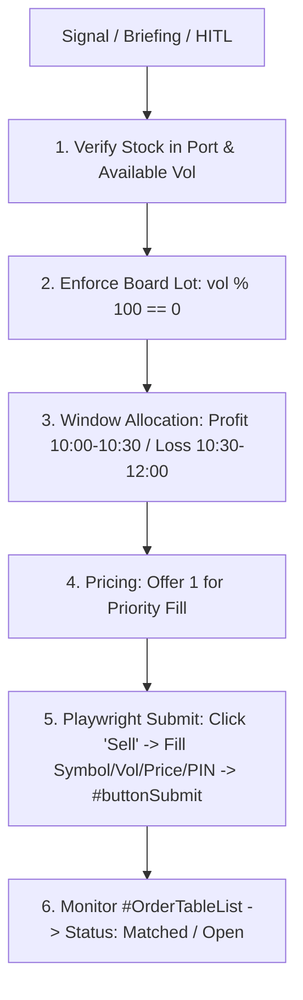
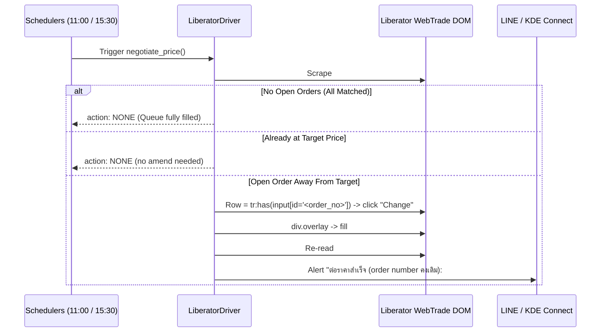

# Operational Runbook: Liberator Securities (WebTrade) Portfolio & Order Execution
**Broker Platform:** `LIBERATOR` (Liberator WebTrade Portal)  
**Main URL:** `https://webtrade.liberator.co.th`  
**Target Account:** Cash Balance (`<liberator-acct>` / `70559382 C`)  
**Verified On:** 2026-10-03 (SET Market Closed / Weekend Staged Mode)  
**Status:** `VERIFIED & PRODUCTION-READY`  

---

## 1. Overview & Capabilities Across 6 Pillars
Liberator WebTrade runs in a modern Single Page Application (SPA). Because account `70559382 C` is a **Cash Balance** account, capabilities map as follows:

| Pillar | Capability | Implementation / Status | Verified Selectors / Artifacts |
| :---: | :--- | :---: | :--- |
| **Pillar 1** | Session & Auth Health | 🟢 Production Ready | Zero-OTP Fast-Path (<2s), Headed Chrome, KDE Connect SMS 2FA |
| **Pillar 2** | Pre-Market & Watchlist | 🟢 Ready | WebTrade Real-time quotes, Streaming Depth (`Vol \| Bid \| Offer \| Vol`) |
| **Pillar 3** | Trade Order Execution | 🟡 Verified / Market Open Hold | Verified DOM form, Auto PIN, SET Board Lot (x100) validation |
| **Pillar 4** | SBL Inventory & Borrow | ⚪ N/A (Cash Balance) | Not applicable for Cash Balance accounts (Margined only) |
| **Pillar 5** | Portfolio & PnL Sync | 🟢 Production Ready | Multi-table deterministic scraping, Cash, Line Available, Holdings |
| **Pillar 6** | Tactical Strategy & Exit | 🟡 Staged for Market Open | Order Status table monitoring, execution tracking |

---

## 2. Verified DOM Selectors & Table Structures

### A. Account Balances Header Cards
Extracted from header card elements (`div`, `p`, `span`):
- **Account Number & Type:** `70559382 (C)` (Cash Balance)
- **Credit Limit:** Regex `Credit Limit:\s*([\d,]+\.?\d*)` -> `฿500,000.00`
- **Line Available:** Regex `Line Available:\s*([\d,]+\.?\d*)` -> `฿134,814.63`
- **Cash Balance:** Regex `Cash Balance:\s*([\d,]+\.?\d*)` -> `฿2,120.45`
- **Total Market Value:** Sum of holdings market values -> `฿140,825.00`
- **Total Equity:** `Cash Balance + Total Market Value` -> `฿142,945.45`
- **Total Unrealized PnL:** Sum of holdings unrealized PnL -> `+฿1,802.44`

### B. Holdings Table (Table 0)
Deterministic identification: `table` whose `thead` contains `"symbol"` and `"in port"`.

| Column # | Column Name | Sample Scraped Value | Field Mapping |
| :---: | :--- | :---: | :--- |
| 0 | Symbol | `BCH`, `BCP`, `IVL`, `RCL`, `THAI` | `symbol` (Uppercase SET stock) |
| 1 | Act Vol | `4,000` | `available_volume` / `act_vol` |
| 2 | In Port | `4,000` | `volume` / `in_port` |
| 3 | Avg Cost | `11.11` | `avg_cost` (฿) |
| 4 | Market Price | `11.20` | `market_price` (฿) |
| 5 | Amount Cost | `44,427.02` | `amount_cost` (฿) |
| 6 | Market Value | `44,800.00` | `market_value` (฿) |
| 7 | Unreal P/L | `+372.98` / `–11.61` | `unrealized_pnl` (Note: handles `–` U+2013) |
| 8 | %Unreal P/L | `0.83` / `-0.06` | `pct_unrealized_pnl` (%) |
| 9 | Realized P/L | `0.00` / `–301.01` | `realized_pnl` (฿) |

### C. Place Order Form (Footer Bar)
Verified interactively without submission (`scripts/test_liberator_order_form_safe.py`):

| Control | Target Selector | Interaction / Action |
| :--- | :--- | :--- |
| **Side: Buy** | `page.locator(":text('Buy')").first` | Click (Toggles submit button to `"Buy"`) |
| **Side: Sell** | `page.locator(":text('Sell')").first` | Click (Toggles submit button to `"Sell"`) |
| **Symbol Input** | `#SearchSymbolList-setBuySellFooter` | `fill("BCH")` |
| **Volume Input** | `#volume` | `fill("100")` (Multiple of 100) |
| **Price Input** | `#price` | `fill("11.00")` (Limit price) |
| **PIN Input** | `#pin` | `fill(settings.LIBERATOR_PIN)` (6-digit PIN) |
| **Submit Button** | `#buttonSubmit` | Submit order (Only during SET Market Hours) |
| **Clear Button** | `button:has-text('Clear')` | Click (Resets inputs safely) |

### D. Orders Status Table (Table 2)
Deterministic identification: `table` whose `thead` contains `"order #"` and `"side"`.

| Field | Selector / Position | Description |
| :--- | :--- | :--- |
| `order_no` | Token 0 (`^\d+$`) | Unique SET Order ID (e.g. `14560`) |
| `time` | Token 1 (`\d{2}:\d{2}:\d{2}`) | Order timestamp (e.g. `10:39:45`) |
| `symbol` | Token 2 | Stock ticker (e.g. `THAI`) |
| `side` | Token 3 | `BUY` or `SELL` |
| `price` | Token 4 | Order price |
| `volume` | Token 5 | Total requested volume |
| `matched` | Token 6 | Matched volume |
| `balance` | Token 7 | Remaining unmatched volume |
| `cancelled`| Token 8 | Cancelled volume |
| `status` | Token 9 | Order state (`Matched`, `Queued`, `Cancelled`) |

---

## 3. CLI Verification Commands
```bash
# 1. Health & Config status
.venv/bin/python -m app.brokers.liberator.cli status

# 2. Portfolio, Balances, & Orders live query
.venv/bin/python -m app.brokers.liberator.cli portfolio

# 3. Interactive Headed Login & KDE Connect 2FA runner
.venv/bin/python -m app.brokers.liberator.cli login

# 4. Trigger Tactical Action Exit (Sell)
.venv/bin/python -m app.brokers.liberator.cli action-exit --symbol BCP --reason "Take Profit +4.2%"

# 5. Trigger Passive Queue Pegging (ต่อราคา) on unmatched orders
.venv/bin/python -m app.brokers.liberator.cli negotiate
```

---

## 4. Pillar 6 — Tactical Action Exit Protocol (Liberator Cash)



### Protocol Steps:
1. **Holding Verification**: Checks available volume (`in_port` / `available_volume`) for the stock (`BCH`, `BCP`, `IVL`, `RCL`, `THAI`). Cannot sell more than shares owned.
2. **Timing Windows**:
   - **Profit Exits** (`pnl_pct >= 0`): 10:00 – 10:30 BKK (Morning liquidity discovery, lock gain, unlock cash).
   - **Stop Loss Exits** (`pnl_pct < 0`): 10:30 – 12:00 BKK (Wait for morning noise to settle before noon).
3. **Execution**:
   - Dispatched automatically by `app.services.action_exit_dispatcher.action_exit_dispatcher` (15s check loop).
   - Form filled and submitted via `LiberatorDriver.execute_order(symbol, side="SELL", volume, price)`.
   - On submission success, pushes immediate KDE Connect notification to phone.

---

## 5. Pillar 6 — Tactical Price Negotiation Protocol (ต่อราคา)



### Protocol Steps (revised 2026-10-09 — amend **IN PLACE**, ไม่มี cancel + re-place แล้ว)
1. **Schedule**: Evaluated twice daily at **11:00 BKK** (Round 1) and **15:30 BKK** (Round 2) by
   `app/services/action_exit_dispatcher.py::_run_autonomous_negotiation()`.
2. **Identification**: `scrape_portfolio()` → orders where `balance > 0` and status is not `Matched`/`Cancelled`.
3. **Amend IN PLACE** — `LiberatorDriver.change_order(order_no, new_price)` presses the broker's native
   **`Change`** control. It **never** cancels and **never** submits a replacement: the original order number
   *and* its queue slot are preserved (a re-placed order would show a new `Order #` **and** a new `Time`).
4. **Proven selectors** (live 2026-10-09, order `#11894` BCH SELL ฿12.00 → ฿11.70, `status=Changed`):

   | Step | Selector |
   | :-- | :-- |
   | Row anchor | `#OrderTableList tbody tr:has(input[id='<order_no>'])` (checkbox id == order number) |
   | Press Change | last `<td>` → `div.cursor-pointer` whose text is exactly `Change` |
   | Amend fields | **scoped** `div.overlay` → `#volume` / `#price` / `#pin` |
   | Submit | `div.overlay #confirmDialogActiveButton` (text `Confirm`) |

5. **🐛 Two traps that silently break this flow**
   - **`LIB-RCA-016`** — never anchor the row with a `\b`-regex: this Vue table's `textContent` has **no
     whitespace between cells** (`'1189410:03:21BCHSELL12.004,00004,0000Open Change  Detail  Cancel '`),
     so `\b11894\b` matches **nothing**. Use the checkbox id anchor instead.
   - **`LIB-RCA-017`** — `#volume` / `#price` / `#pin` exist **TWICE** in the DOM (Buy/Sell footer first,
     amend overlay second) → always scope the amend fields with `div.overlay`, otherwise the footer is filled.
6. **Response contract**: `action="AMENDED_IN_PLACE"` + `order_no` (**unchanged**) + `old_price`/`new_price`;
   `action="NONE"` when already at target (no pointless submission); `action="AMEND_UNVERIFIED"` when the grid
   does not confirm the new price (**Anti-Mock** — success is reported only after re-reading `#OrderTableList`).
7. **Audit Trail**: the unchanged order number + old/new price are logged and pushed to LINE / KDE Connect.

---

## 6. Market Hours Operational Policy
- **Weekend / After-Hours:** Live order placement is safely staged by pre-flight validation in `LiberatorBrokerPlugin.place_order`.
- **Monday Market Open (09:55 - 16:35 BKK):** Live tactical entry, price adjustment, and exits can be initiated seamlessly using the verified selectors.

---

## 7. Order Ledger — Orders sent to broker (Matched vs Unmatched)

**Change:** Order-Ledger addition (2026-10-07). Liberator's portfolio Orders table already carries the
full row: `order_no, time, symbol, side, price, volume, matched, balance, cancelled, status`.

| Method | Behavior |
| :--- | :--- |
| `LiberatorBrokerPlugin.get_orders()` | raw `orders[]` as scraped |
| `LiberatorBrokerPlugin.get_open_orders()` | **only** open/unmatched (`balance > 0`, status not Matched/Cancelled) — for price negotiation |
| `LiberatorBrokerPlugin.get_all_orders()` | **ALL** rows (matched + partial + open + cancelled) — for the Order Ledger |

```python
# MCP tool (Pillar 2) — Order Ledger (single-account CASH)
await current_orders(platform="LIBERATOR")
```

**Live evidence (2026-10-07):** `current_orders(platform="LIBERATOR")` คืน order จริง 1 รายการ —
`THAI SELL 3400 @ ฿5.75` → `matched_volume=3400, balance=0` → category `MATCHED` ✅

---

## 8. Market Quote — Bid1 / Offer1 (/ last) for the LINE CLI `/nego lib` (2026-10-13)

**Change:** `LiberatorDriver.get_market_bid_offer(symbol)` (passthrough:
`LiberatorBrokerPlugin.get_market_bid_offer`) — added for the LINE slash-command CLI so
`/nego lib` can apply the same guardrails as KSS (G5 tick distance / G6 SHORT uptick).

**Method**
1. Reuse the active Portfolio page (never auto-logins — Invariant 7).
2. Select the symbol on the footer buy/sell form: `#SearchSymbolList-setBuySellFooter` + `Enter`
   (same proven selector used by `execute_order`).
3. In-page JS isolates the depth table **by header** (thead contains both `bid` and `offer`) —
   the same deterministic-table-isolation pattern as `_extract_portfolio_from_page`
   (see LIB-RCA-005, "5-Bid/Offer Depth" = Table 1). `last` is read only from a column whose
   header contains `last`; it is **not** substituted from the holdings market price.

**Anti-Mock / fail-closed (updated 2026-10-15 · LIB-RCA-019):** when the page is not open, the
depth table cannot be found, the side we need is empty, or the parse yields nothing → returns the
**explicit** `QUOTE_UNAVAILABLE` envelope — `success=False`, `status="QUOTE_UNAVAILABLE"`,
`source="unavailable"`, `bid_1/offer_1/last = None`, `error=<reason>`. The old `_unknown_quote()`
sentinel is gone; the caller MUST halt (never trade on a guess, never fall back to the order's own
price). Success shape carries `success=True`, `status="OK"`, `source="liberator_board"`.

> ⚠️ Selector-heuristic status: the header-isolation rule is evidence-anchored (LIB-RCA-005) but the
> depth table's exact `<th>` wording has **not** yet been re-verified on a live headed session.
> Pending live confirmation — see TASK-line-cli Open questions.

```python
# LINE CLI handler (Broker Isolation)
quote = await liberator_plugin.get_market_bid_offer("PTT")
# {"symbol": "PTT", "bid_1": ..., "offer_1": ..., "last": ..., "source": "liberator_board"|"unavailable"}
```
