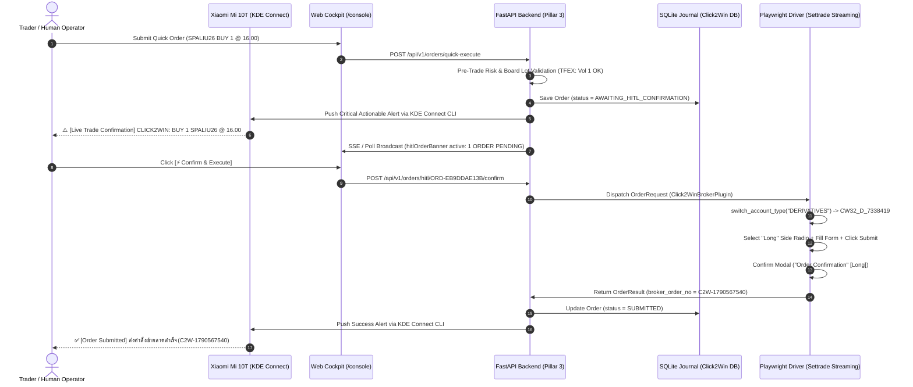

# Learned Workflow: Human-In-The-Loop (HITL) Web Cockpit & Mobile Alert Architecture

> **Status**: ✅ **VERIFIED LIVE END-TO-END IN PRODUCTION SANDBOX**
> **Executed & Validated At**: 2026-09-28 10:52:21 ICT
> **Target Asset**: `SPALIU26` (TFEX Single Stock Futures)
> **Order ID**: `ORD-EB9DDAE13B` | **Broker Ref**: `C2W-1790567540`
> **Mobile Target**: Xiaomi Mi 10T (`9507a3fd53f848da9135ebe6253db18a`) via Tailscale & Zero-Cloud Wi-Fi
> **Web Cockpit**: `http://localhost:8000/console`

---

## 1. Architecture & Protocol Sequence



---

## 2. Key Verification Milestones

1. **Pre-Trade Asset-Aware Validation**:
   - `validator.is_tfex_symbol("SPALIU26")` evaluates to `True`.
   - `validate_board_lot(volume=1, symbol="SPALIU26")` permits odd volume `1` for TFEX contracts, avoiding the Equity `volume % 100 == 0` constraint.
2. **KDE Connect Mobile Isolation**:
   - Outbound alerts strictly route to Xiaomi Mi 10T (`9507a3fd53f848da9135ebe6253db18a`).
   - Secondary paired device NUC-Intel (`92bf51aaea244830b7ed6a9af0115556`) is explicitly ignored to prevent notification spam.
3. **Cockpit Banner Synchronicity**:
   - When orders are pending, `#hitlOrderBanner` illuminates with countdown / count badge: `1 ORDER PENDING`.
   - Batch actions (`Confirm All`, `Reject All`) enable multi-order management if multiple orders queue concurrently.
4. **Clean Playwright Dispatching**:
   - Bypasses any modal errors before switching accounts.
   - Detects account in live DOM before performing unnecessary clicks.
   - Dynamically checks submit button label (`Long` vs `Submit`).
   - Automatically confirms the secondary dialog modal.

---

## 3. Database & Audit Trail Proof

```
[ORD-EB9DDAE13B] BUY 1 SPALIU26 @ 16.0 | Status: SUBMITTED | BrokerNo: C2W-1790567540
```
- **Session Log**:
  `[2026-09-28 03:52:21] CLICK2WIN_ORDER_SUBMITTED: Submitted: BUY 1 SPALIU26 @ ฿16.00 (C2W-1790567540)`
- **Uvicorn Daemon**:
  Hot-reload enabled with `--timeout-graceful-shutdown 1` ensuring SSE client connections do not deadlock server reloads.
